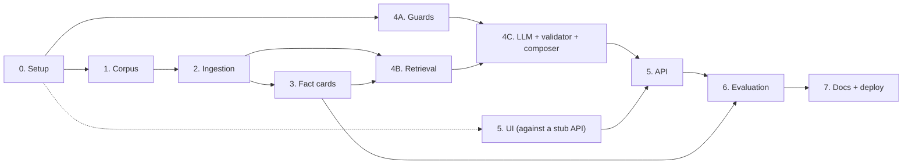

# Implementation Plan: Mutual Fund FAQ Assistant

> **Disclaimer:** Facts-only. No investment advice.

This plan turns [architecture.md](architecture.md) into build phases. Requirements come from [problemStatement.md](problemStatement.md). Section numbers like "§6.2" refer to the architecture document.

Each phase lists its goal, what it depends on, tasks, deliverables and exit criteria. A phase is done only when its exit criteria pass.

Corner cases are listed in [edge-case.md](edge-case.md). Tasks that close a gap found there are tagged with the case IDs, e.g. (EC-INT-16).

How each phase is evaluated, and the system-level release targets, are defined in [eval.md](eval.md). A phase gate is its exit criteria here plus the checks there.

**LLM provider: Groq.** Answers and fact extraction use `openai/gpt-oss-120b` through the official `groq` Python SDK. On Groq this model supports strict JSON-schema output, which the answer step relies on (architecture D7).

---

## Overview

| Phase | Name | Depends on | Estimate* |
|---|---|---|---|
| 0 | Project setup | — | 0.5–1 day |
| 1 | Corpus definition | 0 | 0.5–1 day |
| 2 | Ingestion pipeline | 1 | 3–4 days |
| 3 | Fact cards | 2 | 2 days |
| 4A | Guards (PII, intent, scheme resolver) | 0 | 2–3 days |
| 4B | Retrieval | 2, 3 | 1–2 days |
| 4C | LLM step, validator, composer, pipeline | 4A, 4B | 2–3 days |
| 5 | API and user interface | 4C (UI can start after 0) | 2 days |
| 6 | Evaluation and tuning | 3, 5 | 2–3 days |
| 7 | Docs, packaging and deployment | 6 | 1–2 days |

\*Rough estimates for one developer, about 17–23 working days in total. Phase 4A and the UI part of Phase 5 can run in parallel with Phases 1–3.



**Suggested calendar (one developer)**

| Week | Work |
|---|---|
| 1 | Phase 0, Phase 1, start Phase 2. Phase 4A in gaps. |
| 2 | Finish Phase 2, Phase 3, Phase 4B, Phase 4C. |
| 3 | Phase 5, Phase 6. |
| 4 | Phase 7, buffer for tuning and fixes. |

---

## Phase 0: Project Setup

**Goal:** an empty but runnable project with the folder layout from §14.

**Depends on:** nothing.

### Tasks

- [ ] Create `pyproject.toml` with the dependencies from §13: `fastapi`, `uvicorn`, `groq`, `sentence-transformers`, `chromadb`, `rank-bm25`, `rapidfuzz`, `httpx`, `trafilatura`, `beautifulsoup4`, `pysbd`, `pydantic`, `pydantic-settings`, `slowapi`, `pyyaml`, `tzdata` (time zone data; Windows has none built in, and the footer needs Asia/Kolkata). Dev dependencies: `pytest`, `ruff`.
- [ ] Create the folder skeleton from §14 (`app/`, `ingestion/`, `config/`, `data/`, `eval/`, `tests/`), with empty `__init__.py` files.
- [ ] Add `.gitignore`: `.env`, `data/raw/`, `data/index/`, `data/reports/`, `data/registry.sqlite`, `__pycache__/`, `.venv/`.
- [ ] Add `.env.example` with every variable in the configuration table below.
- [ ] Write `app/settings.py` using `pydantic-settings`, reading the variables below with their defaults. The API key is a secret type, so it never appears when settings are printed (EC-SEC-05).
- [ ] In production (`APP_ENV=production`), refuse to start if `DEBUG_LOG_QUERIES` is on (EC-PII-18).
- [ ] Write a minimal `app/main.py` with `GET /healthz` returning `{"index_loaded": false}`.
- [ ] Add one smoke test and configure `pytest` and `ruff`.

### Configuration

Same as architecture §15.

| Variable | Default | Purpose |
|---|---|---|
| `GROQ_API_KEY` | — | Groq API key. The app starts without it; answers that need the LLM return `503` |
| `GROQ_MODEL` | `openai/gpt-oss-120b` | Model for answers and fact extraction |
| `GROQ_FALLBACK_MODEL` | empty (off) | Optional second model, tried once after a rate limit or server error (e.g. `openai/gpt-oss-20b`) |
| `LLM_REASONING_EFFORT` | `low` | `reasoning_effort` for answers |
| `EXTRACTION_REASONING_EFFORT` | `medium` | `reasoning_effort` for offline fact extraction |
| `LLM_MAX_TOKENS` | `2048` | Completion token limit. Reasoning tokens count toward it |
| `JUDGE_MODEL` | `qwen/qwen3.8-27b` | Advice judge, evaluation only. A different model family from the answer model |
| `APP_ENV` | `development` | `development` or `production` |
| `INDEX_DIR` | `data/index` | Where index versions live |
| `RETRIEVAL_TOP_K` | `5` | Chunks sent to the LLM |
| `MIN_SIMILARITY` | `0.45` | Below this, return `not_found` (tuned in Phase 6) |
| `REQUEST_TIMEOUT_S` | `20` | Per-request time limit |
| `RATE_LIMIT` | `20/minute` | Per-IP limit |
| `DISPLAY_TIMEZONE` | `Asia/Kolkata` | Timezone for the footer date |
| `STALE_SOURCE_DAYS` | `14` | `/healthz` flags pages not fetched for this long |
| `DEBUG_LOG_QUERIES` | `false` | Log redacted questions (local only; blocked in production) |

### Deliverables

- Runnable project skeleton committed to git.

### Exit criteria

- `uv sync` installs cleanly.
- `pytest` passes.
- `uvicorn app.main:app` serves `/healthz`.

---

## Phase 1: Corpus Definition

**Goal:** fix the corpus to exactly the Groww scheme pages listed in the problem statement, and record which facts each page provides.

**Depends on:** Phase 0.

**Corpus decision:** the assistant ingests and cites **only** the URLs below. No AMC, AMFI, SEBI or other pages are added to the corpus. This answers the problem statement's first open question (Groww pages count as the source) and is recorded as architecture decision D1.

| Doc ID | Scheme | URL |
|---|---|---|
| `groww-hdfc-large-cap` | HDFC Large Cap Fund – Direct Growth | https://groww.in/mutual-funds/hdfc-large-cap-fund-direct-growth |
| `groww-hdfc-mid-cap` | HDFC Mid Cap Fund – Direct Growth | https://groww.in/mutual-funds/hdfc-mid-cap-fund-direct-growth |
| `groww-hdfc-small-cap` | HDFC Small Cap Fund – Direct Growth | https://groww.in/mutual-funds/hdfc-small-cap-fund-direct-growth |
| `groww-hdfc-multi-cap` | HDFC Multi Cap Fund – Direct Growth | https://groww.in/mutual-funds/hdfc-multi-cap-fund-direct-growth |
| `groww-hdfc-elss-tax-saver` | HDFC ELSS Tax Saver Fund – Direct Plan Growth | https://groww.in/mutual-funds/hdfc-elss-tax-saver-fund-direct-plan-growth |
| `groww-hdfc-gold-etf-fof` | HDFC Gold ETF Fund of Fund – Direct Plan Growth | https://groww.in/mutual-funds/hdfc-gold-etf-fund-of-fund-direct-plan-growth |
| `groww-hdfc-silver-etf-fof` | HDFC Silver ETF Fund of Fund – Direct Growth | https://groww.in/mutual-funds/hdfc-silver-etf-fof-direct-growth |

### Tasks

**Scheme registry**

- [ ] Write `config/schemes.yaml` with the schemes above: `id`, `name`, `category`, `source_doc_id` and `aliases`.
- [ ] Take aliases from the names and wording used on each Groww page (e.g. "hdfc smallcap", "hdfc mid cap").

**Source manifest**

- [ ] Write `config/sources.yaml` with `groww.in` as the only allowed domain and one entry per scheme page:

  ```yaml
  allowed_domains:
    - groww.in

  documents:
    - id: groww-hdfc-mid-cap
      scheme_id: hdfc-mid-cap
      doc_type: SCHEME_PAGE
      url: https://groww.in/mutual-funds/hdfc-mid-cap-fund-direct-growth
      format: html
      refresh: weekly
    # ... one entry for each URL in the table above, nothing else
  ```

- [ ] Add a test that fails if `sources.yaml` contains any URL not in the table above.

**Checks**

- [ ] Check that `groww.in/robots.txt` and Groww's terms of use allow fetching these pages. If they don't, use the manual-save fallback below.
- [ ] Write `python -m ingestion.check_sources`. It checks each URL is on the allowlist, returns HTTP 200 and is HTML.
- [ ] Save one raw response per page and check that the facts appear in the HTML the fetcher receives, not only after JavaScript runs in a browser. Record the result. If facts are missing, Phase 2 needs a headless browser (e.g. Playwright) or must read the data embedded in the page.
- [ ] Build a **coverage matrix**: schemes × 7 fields (`expense_ratio`, `exit_load`, `min_sip`, `min_lumpsum`, `lock_in`, `riskometer`, `benchmark`). Each cell names the section of the Groww page that shows the fact, or says "not on page". Save it as `docs/coverage-matrix.md`.
- [ ] Add a row for the statement / capital gains download process and note whether any of the pages explain it.
- [ ] Note any "as of" date the page shows next to values such as the expense ratio. If there is none, answers rely on the fetch date in the footer (D2).

**Effects to record**

A Groww-only corpus changes some behavior described elsewhere. Make each decision and record it in `architecture.md`:

- [ ] **Citations:** every answer cites its scheme's Groww page.
- [ ] **Performance questions:** the problem statement asks for a link to the official factsheet. With no extra URLs, the redirect links the scheme's Groww page instead.
- [ ] **Statement and capital gains questions:** if the coverage matrix shows the pages don't cover them, these questions get the `not_found` response.
- [ ] **Refusal links:** refusals must include an educational link (AMFI or SEBI). These would be fixed links in the refusal template, not ingested content. Decide whether to keep one or two in `config/education_links.yaml` (recommended, since the problem statement requires them) or drop them.
- [ ] Draft the three UI example questions so each can be answered from these pages.
- [ ] Make the 12 decisions listed in [edge-case.md](edge-case.md) §18 and record them in `architecture.md`.

### Deliverables

- `config/schemes.yaml`, `config/sources.yaml` (only the URLs above)
- `ingestion/check_sources.py` and the manifest test
- `docs/coverage-matrix.md`
- The decisions above recorded in `architecture.md`

### Exit criteria

- `check_sources` passes for every URL, and the manifest test confirms no other URL is present.
- The coverage matrix is complete, with every gap written down.
- Every decision under "Effects to record" is made and recorded.

### Risk to watch

If Groww blocks scripted requests (HTTP 403 or bot protection), or its terms don't allow fetching, save each page by hand into `data/raw/<doc_id>/` and mark it `fetch: manual` in `sources.yaml`. The Groww URL is still used for the citation. Ingestion then reads the local file.

---

## Phase 2: Ingestion Pipeline

**Goal:** one command that turns the source manifest into a versioned search index (§5).

**Depends on:** Phase 1.

### Tasks

**Registry**

- [ ] Create SQLite tables `documents`, `fact_cards` and `index_builds` (§9) with `CREATE TABLE IF NOT EXISTS`.

**Fetch (`ingestion/fetch.py`, §5.1)**

- [ ] `httpx` client: 20 s timeout, 3 retries with backoff, generic User-Agent, HTTPS only.
- [ ] Check the allowlist before the request and again on the final URL after redirects.
- [ ] Save raw bytes to `data/raw/<doc_id>/<fetched_at>.<ext>`.
- [ ] Store a SHA-256 hash of the **extracted page text** (after stripping, see Parse), not the raw bytes. Groww pages change on every load (daily NAV, timestamps, tokens), so a raw-byte hash would mark every page as changed (EC-ING-03).
- [ ] If that hash is unchanged, update only `fetched_at` and skip chunking and fact extraction.
- [ ] Sanity-check every response: scheme name present, minimum text length, expected sections. A captcha, "access denied" or empty page counts as a failed fetch, even with HTTP 200 (EC-ING-01).
- [ ] If the fetch fails, keep the last good version and record the failure in the run report.
- [ ] Support `fetch: manual` documents from Phase 1.

**Parse (`ingestion/parse_html.py`, §5.2)**

- [ ] HTML: `trafilatura`, with `BeautifulSoup` as fallback. Keep headings and tables. Turn table rows into readable sentences.
- [ ] If Phase 1 found values missing from the raw HTML, read the page's embedded data or render it with a headless browser (e.g. Playwright).
- [ ] Each Groww page covers one scheme, so its chunks take `scheme_id` from the document entry.
- [ ] Strip "similar funds", peer-comparison and other-fund sections, so chunks hold only the scheme's own data (EC-RET-06, EC-FC-02).

**Normalize and chunk (`ingestion/normalize.py`, `ingestion/chunk.py`, §5.3)**

- [ ] Normalize Unicode (NFKC), whitespace, broken hyphenation and currency forms ("₹", "Rs.", "INR").
- [ ] Split on headings, then into ~400-token windows with ~60-token overlap. Never split a table.
- [ ] Add the context header `[Scheme | Doc type | Section]` to each chunk.
- [ ] Attach chunk metadata: `chunk_id`, `doc_id`, `scheme_id`, `doc_type`, `section`, `source_url`, `doc_as_of`.

**Embed and index (`ingestion/embed.py`, `ingestion/build_index.py`, §5.5)**

- [ ] Embed with `BAAI/bge-small-en-v1.5`, normalized vectors, in batches.
- [ ] Write ChromaDB and the BM25 index into `data/index/v<timestamp>/`.
- [ ] Switch the `current` pointer only after a successful build: write a temp file, then `os.replace`.
- [ ] Record the build in `index_builds`.

**CLI and inspection**

- [ ] `python -m ingestion.run`, with `--only <doc_id>`. Writes a run report to `data/reports/ingest_<date>.md`.
- [ ] `python -m ingestion.inspect --scheme <id>` prints chunks so they can be checked by eye.
- [ ] Use a lock file so two ingestion runs can't overlap. A second run exits with a message (EC-ING-08).

**Tests**

- [ ] Save sample Groww page HTML files in `tests/fixtures/`.
- [ ] Test parsers on the fixtures.
- [ ] Test that a table is never split across chunks.
- [ ] Test that a non-allowlisted URL and an off-allowlist redirect are both rejected.
- [ ] Test that the index pointer is unchanged when a build fails partway.
- [ ] Test that a captcha or empty-page fixture is treated as a failed fetch.
- [ ] Test that two copies of a page differing only in NAV or timestamps give the same hash.
- [ ] Test that peer-fund sections are removed from a Groww page fixture.
- [ ] Test that a second ingestion run exits while the first holds the lock.

### Implementation note

The footer date (D2) should be read from the `documents` table by `doc_id` when composing the response, not from chunk metadata. A document whose content hash is unchanged then shows its new `fetched_at` without rebuilding the index.

### Deliverables

- Working `ingestion/` package, the registry and the first full index.

### Exit criteria

- A build from scratch succeeds and the run report shows every document as fetched, unchanged, failed or skipped.
- A second run skips unchanged documents.
- `inspect` output looks correct for at least 2 schemes, including the exit-load table.
- Ingestion tests pass.

---

## Phase 3: Fact Cards

**Goal:** reviewed, structured records for the 7 key fields of each scheme (D10, §5.4).

**Depends on:** Phase 2.

### Tasks

- [ ] For each scheme and field, pick candidate chunks with a BM25 search on field keywords within that scheme (e.g. "exit load", "redeemed", "redemption").
- [ ] Call the Groq model (`GROQ_MODEL`) once per scheme × field, with `response_format` set to `json_schema` and `strict: true`. Fields: `status` (`found` / `not_found`), `field`, `value`, `verbatim_quote`, `source_doc_id`, `doc_as_of`. Extraction runs offline, so use `EXTRACTION_REASONING_EFFORT` (`medium`).
- [ ] Reject any card whose `verbatim_quote` is not found in the normalized source text.
- [ ] Compare each value with the previous build. Write changes to `data/reports/fact_diff_<date>.md`.
- [ ] Write a review CLI, `python -m ingestion.review_facts`. It shows each card with its quote and source URL, and lets you mark it reviewed or rejected.
- [ ] Index **only reviewed** cards, rendered as short text chunks with `doc_type: FACT_CARD`. Their `source_url` is the scheme's Groww page.
- [ ] Re-extract only when the source document's hash has changed, to limit API cost.
- [ ] Store the source content hash on each card. When the page's hash changes, withdraw its cards from the index until new ones are reviewed, so an outdated value is never served (EC-RET-04, EC-FC-06).

### Tests

- [ ] With a fake LLM: a card with a quote that is not in the source is rejected.
- [ ] Change a value in a fixture and confirm it appears in the diff report.
- [ ] Unreviewed cards are not indexed.
- [ ] A reviewed card whose source hash has changed is withdrawn from the index.

### Deliverables

- `ingestion/fact_cards.py`, `ingestion/review_facts.py`
- Up to 49 reviewed cards (7 schemes × 7 fields), with non-applicable or missing ones documented.

### Exit criteria

- Every applicable card is reviewed against the live Groww page.
- The diff report works on a second run.

---

## Phase 4A: Guards

**Goal:** the deterministic checks that run before retrieval (§6.2–6.4). They need no index, so this phase can run alongside Phases 1–3.

**Depends on:** Phase 0.

### Tasks

**PII guard (`app/guards/pii.py`, §6.2)**

- [ ] Patterns for PAN, Aadhaar (with Verhoeff checksum), Indian mobile numbers, email, OTP near keywords, and account/folio numbers.
- [ ] Returns a match type only, never the matched text, so nothing sensitive is passed on or logged.
- [ ] Exclude numbers next to "₹", "Rs", "rupees", "lakh" or "crore" from the account-number pattern, so amounts aren't blocked (EC-PII-13).

**Intent rules (`app/guards/intent.py`, §6.3)**

- [ ] Keyword and regex rules for `advisory`, `performance`, `out_of_scope`, `greeting` and `factual`.
- [ ] Fixed priority when several match: `advisory` > `performance` > `out_of_scope` > `greeting` > `factual`. For example, "Which fund has better returns?" is advisory.
- [ ] `greeting` matches only when the whole message is a greeting, so "Hi! What's the exit load of HDFC Mid Cap?" is still answered (EC-INT-16).
- [ ] Exception patterns so factual wording isn't refused: "should I pay", "do I have to pay", "is there a", "best way to", "return / redeem units", "portfolio of". Treat "returns" as performance only next to performance words ("1 year", "%", "CAGR", "gave") (EC-INT-02, EC-INT-03, EC-PERF-02, EC-PERF-09).
- [ ] Recognize other AMC names for `out_of_scope`.

**Field detection (`app/retrieval/fields.py`)**

- [ ] Map question words to fact-card fields ("exit load" → `exit_load`, "minimum SIP" → `min_sip`, "riskometer" / "risk level" → `riskometer`). Used by the scheme resolver and the retriever boost.

**Scheme resolver (`app/retrieval/scheme_resolver.py`, §6.4)**

- [ ] Exact alias match, then `rapidfuzz` token-set ratio ≥ 85.
- [ ] Category words ("ELSS", "silver", "gold", "multi cap") map to schemes.
- [ ] **Before** fuzzy matching, detect other AMC names and HDFC schemes outside the corpus. Otherwise "SBI Small Cap" can match the "small cap" alias and return HDFC facts (EC-SCH-06, EC-SCH-07).
- [ ] Detect Regular plan, IDCW option, and the plain Gold or Silver ETF (as opposed to the FoF). Their facts differ from the corpus schemes, so they must not resolve to them (EC-SCH-05, EC-SCH-09).
- [ ] Returns one of: one scheme, general question, scheme needed but missing, several schemes, or not covered (other AMC, other HDFC scheme, Regular/IDCW plan, ETF instead of FoF).

### Tests

- [ ] PII true positives: valid PAN, a checksum-valid test Aadhaar number, `+91` mobile, email, "my OTP is 482913".
- [ ] PII false positives that must **not** match: "₹500 SIP", "1 year lock-in", "expense ratio 0.75%", a 4-digit year.
- [ ] Intent: at least 10 advisory, 5 performance and 5 factual phrasings, including the problem statement's examples.
- [ ] Resolver: aliases, typos ("smallcap", "mid-cap"), two schemes in one question, no scheme.
- [ ] Resolver: "SBI Small Cap", "HDFC Flexi Cap", "HDFC Mid Cap Regular" and "HDFC Gold ETF" never resolve to a corpus scheme.
- [ ] Intent: "Hi! What's the exit load of HDFC Mid Cap?" and "Should I pay exit load if I redeem after 6 months?" are both `factual`.
- [ ] PII: "₹1000000000" and "100000000 rupees" are not blocked.

### Deliverables

- `app/guards/pii.py`, `app/guards/intent.py`, `app/retrieval/fields.py`, `app/retrieval/scheme_resolver.py` and their tests.

### Exit criteria

- All guard tests pass.
- No PII test case reaches code beyond the guard.

---

## Phase 4B: Retrieval

**Goal:** hybrid search that returns the right chunks for a resolved scheme (§6.5).

**Depends on:** Phases 2 and 3.

### Tasks

- [ ] `app/retrieval/index_loader.py`: at startup, read the `current` pointer and load ChromaDB, BM25 and the embedding model. Expose the index version and build date for `/healthz`. A new index is picked up on restart.
- [ ] `app/retrieval/hybrid.py`:
  - [ ] Dense top 10 filtered by `scheme_id`.
  - [ ] BM25 top 10 with the same filter.
  - [ ] Reciprocal Rank Fusion with k = 60.
  - [ ] Boost `FACT_CARD` chunks when a field was detected.
  - [ ] Return the top 5, with the best dense similarity score.
  - [ ] Return "nothing relevant" when the best similarity is below `MIN_SIMILARITY` (0.45 to start).

### Tests

- [ ] Over a small fixture index: "exit load mid cap" returns the mid-cap fact card or page chunk in the top 3.
- [ ] A question about one scheme never returns another scheme's chunks.
- [ ] An unrelated question ("what is the weather") falls below the threshold.

### Deliverables

- Retrieval module and tests.

### Exit criteria

- Retrieval tests pass.
- A manual check of 10 real questions shows a correct supporting chunk in the top 5 for each.

---

## Phase 4C: LLM Step, Validator, Composer and Pipeline

**Goal:** the full question-to-answer pipeline (§6.6–6.8), testable without API cost.

**Depends on:** Phases 4A and 4B.

### Tasks

**LLM client (`app/llm/client.py`, `prompts.py`, `schemas.py`, §6.6)**

- [ ] Groq client (`groq` SDK, `client.chat.completions.create`) with model from `GROQ_MODEL`, `reasoning_effort` from `LLM_REASONING_EFFORT` and the token limit from `LLM_MAX_TOKENS`.
- [ ] Structured output: `response_format={"type": "json_schema", "json_schema": {"name": ..., "strict": True, "schema": ...}}` with the §6.6 schema. Strict mode uses constrained decoding, so the output always matches the schema. It requires every field to be listed in `required` and `additionalProperties: false`. Parse `message.content` with `json.loads` and validate it with the pydantic model.
- [ ] Check `finish_reason` before using the content. `length` (cut off) or empty content counts as a failure: one retry, then `not_found`.
- [ ] Handle SDK errors from most to least specific: rate limit (respect `retry-after`), timeout, other API status errors, connection errors. If `GROQ_FALLBACK_MODEL` is set, try it once after a rate limit or server error, and log which model served the answer. Otherwise return `503` to the caller.
- [ ] Put the fixed system prompt from §6.6 in `prompts.py`. Build the `<sources>` block with XML-escaped chunk text.
- [ ] Define the client behind a small interface so tests can pass in a fake.

**Validator (`app/guards/output_validator.py`, §6.7)**

- [ ] Status handling, `source_id` membership, ≤ 3 sentences (`pysbd`), no links, number/percentage/date grounding against the cited chunk, advisory and return-figure phrase checks.
- [ ] The grounding check also accepts the cited document's `doc_as_of` date, which is metadata rather than chunk text (EC-FLD-12).
- [ ] Returns a list of failed checks, used in the retry message.

**Retry flow**

- [ ] On validation failure, send one follow-up listing the failed checks. On a second failure, return `not_found`.

**Templates and composer (`app/responses/`, `config/templates.yaml`, §6.8)**

- [ ] Write the template texts. Each must be ≤ 3 sentences.
- [ ] Composer builds `ChatResponse`. The citation URL and title come from the registry by `doc_id`. `last_updated` is that document's `fetched_at`.
- [ ] Store times in UTC and show the footer date in Asia/Kolkata, formatted as `10 Nov 2026` (EC-CIT-03).
- [ ] Add "not covered" wording to the `out_of_scope` template for Regular/IDCW plans and ETFs. It names the covered Direct Growth or FoF scheme and links its page (EC-SCH-05, EC-SCH-09).
- [ ] `performance_redirect` links the scheme's Groww page from the registry (architecture §2.1).

**Orchestrator (`app/pipeline.py`)**

- [ ] Order: PII guard → intent rules → scheme resolver → retrieval → LLM → validator → composer.
- [ ] Generate a `request_id`. Write one structured log line per request with the §10 fields and no raw question text.

**Developer CLI**

- [ ] `python -m app.cli ask "<question>"` runs the full pipeline and prints the response and debug details (retrieved chunk IDs, validator result).

### Tests (with a fake LLM)

- [ ] Each LLM status: `answered`, `insufficient_context`, `advisory`, `out_of_scope`.
- [ ] `source_id` not in the retrieved set → retry.
- [ ] Four-sentence answer → retry → valid answer passes.
- [ ] Answer with a number missing from the source → retry → second failure gives `not_found`.
- [ ] `finish_reason: "length"` → retry → `not_found`.
- [ ] Rate limit with `GROQ_FALLBACK_MODEL` set → answered by the fallback model, which is logged.
- [ ] Every response type has the right citation rule (one link, or none for `clarify` / `greeting`) and the footer where required.
- [ ] Log lines never contain the question text.
- [ ] An answer whose only date is the document's as-of date passes grounding.
- [ ] A fetch at 20:00 UTC shows the next day's India date in the footer.

### Deliverables

- `app/llm/`, `app/guards/output_validator.py`, `app/responses/`, `app/pipeline.py`, `app/cli.py`, `config/templates.yaml` and tests.

### Exit criteria

- All tests pass.
- `app.cli ask` gives correct, cited answers for the three draft example questions using the real model.

---

## Phase 5: API and User Interface

**Goal:** the public endpoints (§7) and the single-page UI (§8).

**Depends on:** Phase 4C for the API. The UI can be built earlier against a stub `/api/chat` that returns fixed responses.

### Tasks

**API (`app/api/routes.py`)**

- [ ] `POST /api/chat`: request model with `message` 1–500 characters. Returns `ChatResponse`.
- [ ] `GET /api/meta`: welcome message, three example questions, disclaimer text, list of schemes.
- [ ] `GET /healthz`: index loaded, version and build date.
- [ ] Rate limit with `slowapi` (`RATE_LIMIT`).
- [ ] Error mapping: `422` invalid input, `429` rate limit, `503` index or LLM unavailable.
- [ ] Custom `422` handler that returns field names only. FastAPI's default repeats the input, which could echo a PAN or phone number (EC-PII-15, EC-API-01).
- [ ] Same-origin CORS, Content Security Policy header, static files mounted from `app/static/`.

**UI (`app/static/index.html`, `app.js`, `styles.css`)**

- [ ] Header with the disclaimer **"Facts-only. No investment advice."**, always visible.
- [ ] Welcome message and three example-question chips loaded from `/api/meta`. Clicking a chip sends it.
- [ ] Answer bubbles show text, a "Source" link and the footer. Links open in a new tab with `rel="noopener noreferrer"`.
- [ ] Render all text with `textContent` (never `innerHTML`) so answers can't inject HTML.
- [ ] Client-side PII check that warns before sending, plus the hint under the input box.
- [ ] Loading state, friendly error messages for `429` and `503`.
- [ ] History in page memory only. No cookies, local storage or analytics.
- [ ] Accessibility: labeled input, keyboard use, focus states, an `aria-live` region for new answers, readable contrast, works at phone width.

### Tests

- [ ] API tests with FastAPI `TestClient` and a fake pipeline: validation errors (never echoing the input), rate limit, response schema, `/api/meta` content.

### Manual checklist

- [ ] Disclaimer visible on load and while scrolling.
- [ ] Each example chip returns a cited answer with the footer.
- [ ] An advisory question shows a polite refusal with an education link.
- [ ] A message containing a PAN shows the warning and, if sent, the `pii_blocked` response.
- [ ] Layout works at 375 px width and with keyboard only.

### Deliverables

- `app/api/routes.py`, `app/static/*` and API tests.

### Exit criteria

- API tests pass and the manual checklist is complete.

---

## Phase 6: Evaluation and Tuning

**Goal:** measure the system against the §12 targets and tune it until they are met.

**Depends on:** Phases 3 and 5.

### Tasks

**Golden set (`eval/golden_set.yaml`)**

- [ ] Write about 80 labeled questions using the groups in §12.1.
- [ ] Add every case marked **E** in [edge-case.md](edge-case.md). This takes the set to roughly 130 questions.
- [ ] Take expected values from the live Groww pages, read by a person. Never copy them from system output.
- [ ] For lock-in questions on non-ELSS schemes, the expected result depends on what the pages state: a factual answer if a source says so, otherwise `not_found`.
- [ ] Hold back about 20 questions, ideally written by someone else, and use them only for the final check to avoid tuning to the test.

**Eval runner (`eval/run_eval.py`)**

- [ ] Run each question through the real pipeline.
- [ ] Check: response type, expected value (normalized match), cited document, format rules (≤ 3 sentences, one link, footer), and that PII cases never reached the LLM client.
- [ ] Check citation validity: URL on the allowlist, HTTP 200, and the fact's text present in the fetched document.
- [ ] Write a scorecard to `data/reports/eval_<date>.md` listing every failure.

**Tuning loop**

- [ ] Change one thing at a time, then re-run: `MIN_SIMILARITY`, intent rules, aliases, field keywords, prompt wording, fact-card boost.
- [ ] Record each change and its effect in the scorecard history.
- [ ] Consider the cross-encoder reranker (§6.5) only if ranking errors remain.

**Cost**

- [ ] Each full run makes about 100 LLM calls once the edge cases are included (template responses are free). Groq's rate limits (requests and tokens per minute, requests per day) matter more than price here: throttle the runner to stay under them, and record rate-limit waits separately from latency. Measure real token usage from each response's `usage`.

### Deliverables

- `eval/golden_set.yaml`, `eval/run_eval.py`, scorecards in `data/reports/`.

### Exit criteria

All §12.2 targets met on the full set and on the held-back questions:

| Metric | Target |
|---|---|
| Factual accuracy | ≥ 95% |
| Citation validity | 100% |
| Format compliance | 100% |
| Advisory refusal recall | 100% |
| False refusals on factual questions | ≤ 5% |
| PII blocked before the LLM | 100% |

---

## Phase 7: Docs, Packaging and Deployment

**Goal:** the required deliverables and a running deployment.

**Depends on:** Phase 6.

### Tasks

**README (required by the problem statement)**

- [ ] Setup instructions: prerequisites, `uv sync`, `.env`, `python -m ingestion.run`, fact-card review, `uvicorn app.main:app`.
- [ ] Selected AMC and the 7 schemes.
- [ ] Architecture overview of the RAG approach, with a link to `docs/architecture.md`.
- [ ] Known limitations (§18).
- [ ] Disclaimer snippet: **"Facts-only. No investment advice."**

**Packaging**

- [ ] `Dockerfile`: slim Python base, install with `uv`, download the embedding model at build time, run as a non-root user, add a `HEALTHCHECK` on `/healthz`.
- [ ] Decide how the index ships: built in CI and copied into the image, or mounted from a volume.

**Deployment**

- [ ] Deploy to a container host with about 1 GB RAM. Set `GROQ_API_KEY` as a secret.
- [ ] Smoke test the deployed URL: `/healthz`, the three example questions, one advisory question, one PII message.

**Refresh routine**

- [ ] Write a short runbook in the README (below).
- [ ] Optional: a scheduled job (e.g. GitHub Actions cron) that runs ingestion monthly and opens a report for review.

### Release checklist

- [ ] All tests pass.
- [ ] Latest eval scorecard meets the targets.
- [ ] `/healthz` shows the expected index version and build date.
- [ ] Disclaimer visible in the deployed UI.
- [ ] No secrets or `data/raw/` files committed.

### Deliverables

- README, Dockerfile, deployed instance.

### Exit criteria

- A fresh clone runs by following only the README.
- The deployed instance passes the smoke test.

---

## Ongoing Operations: Monthly Refresh

Each month (expense ratio and riskometer values on the pages usually change monthly):

1. Run `python -m ingestion.run`.
2. Read the run report. Fix any failed fetches or moved URLs in `sources.yaml`.
3. Review `fact_diff_<date>.md` with `python -m ingestion.review_facts`.
4. Run `python -m eval.run_eval` and confirm the targets still hold.
5. Restart or redeploy so the server loads the new index. Confirm the build date on `/healthz`.

---

## Requirement Traceability

How each problem-statement requirement is built and checked.

| Requirement | Built in | Component | Verified by |
|---|---|---|---|
| Answer facts: expense ratio, exit load, min SIP, lock-in, riskometer, benchmark | 3, 4B, 4C | Fact cards, hybrid retrieval, LLM step | Golden set fact groups |
| Statement / capital gains process | 1 | Coverage matrix; `not_found` if the pages don't cover it (architecture §2.1) | Golden set process group |
| At most 3 sentences | 4C | Validator, templates | Unit tests, eval format compliance |
| Exactly one citation link | 4C | Composer, `source_id` mapping | Unit tests, eval citation checks |
| Footer "Last updated from sources: <date>" | 4C | Composer (D2) | Unit tests, eval format compliance |
| Refuse advisory questions politely, with an education link | 4A, 4C | Intent rules, LLM `advisory` status, refusal template | Intent tests, golden set advisory group |
| Performance questions: no figures, link only (scheme's Groww page, architecture §2.1) | 4A, 4C | Intent rules, `performance_redirect`, validator policy check | Golden set performance group |
| Sources: only the Groww scheme pages from the problem statement (Phase 1 decision) | 1, 2 | `groww.in` allowlist and fixed manifest | Manifest test, ingestion tests, citation validity |
| No PAN, Aadhaar, account numbers, OTPs, email, phone | 4A, 4C, 5 | PII guard, log policy, client-side warning | PII tests, golden set PII group |
| Welcome message, three examples, visible disclaimer | 5 | Static UI, `/api/meta` | Manual checklist |
| README: setup, AMC + schemes, architecture, limitations | 7 | README | Fresh-clone check |
| Disclaimer snippet | 5, 7 | UI header, README | Manual checklist |

---

## Risks Across Phases

| Risk | Phase | Response |
|---|---|---|
| Groww blocks scripted requests or loads facts with JavaScript | 1, 2 | Manual save with `fetch: manual` (Groww URL kept for citations), or a headless browser. |
| Groww page layout changes and breaks extraction | 2, 3 | Verbatim-quote check and the fact-card diff report catch changed or missing values. |
| Table parsing errors in exit-load or expense-ratio tables | 2, 3 | Verbatim-quote check and human review of every card. |
| Intent rules refuse too many factual questions | 4A, 6 | Measure false refusals in the eval and adjust the rules. |
| Groq retires or changes the chosen model | 4C, 6 | The model ID is config. Re-run the generation and golden-set evals after any model change. The client sits behind an interface, so changes stay local. |
| Groq rate limits slow evaluation or fail live requests | 4C, 6 | Throttled eval runner, retries that respect `retry-after`, optional `GROQ_FALLBACK_MODEL`, and a friendly `503`. |
| Eval tuning overfits to the golden set | 6 | Held-back questions used only for the final check. |
| API cost during development | 3, 6 | Fake LLM in tests, re-extract fact cards only on changed documents, run the eval deliberately. |
