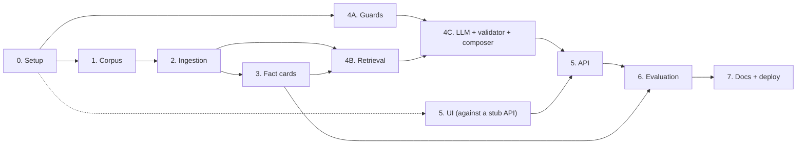

# Implementation Plan: Mutual Fund FAQ Assistant

> **Disclaimer:** Facts-only. No investment advice.

This plan turns [architecture.md](architecture.md) into build phases. Requirements come from [problemStatement.md](problemStatement.md). Section numbers like "§6.2" refer to the architecture document.

Each phase lists its goal, what it depends on, tasks, deliverables and exit criteria. A phase is done only when its exit criteria pass.

Corner cases are listed in [edge-case.md](edge-case.md). Tasks that close a gap found there are tagged with the case IDs, e.g. (EC-INT-16).

How each phase is evaluated, and the system-level release targets, are defined in [eval.md](eval.md). A phase gate is its exit criteria here plus the checks there.

**LLM provider: Groq.** Answers and fact extraction use `openai/gpt-oss-120b` through the official `groq` Python SDK. On Groq this model supports strict JSON-schema output, which the answer step relies on (architecture D7).

---

## Overview

| Phase | Name | Depends on | Estimate* |
|---|---|---|---|
| 0 | Project setup | — | 0.5–1 day |
| 1 | Corpus definition | 0 | 0.5–1 day |
| 2 | Ingestion pipeline | 1 | 3–4 days |
| 3 | Fact cards | 2 | 2 days |
| 4A | Guards (PII, intent, scheme resolver) | 0 | 2–3 days |
| 4B | Retrieval | 2, 3 | 1–2 days |
| 4C | LLM step, validator, composer, pipeline | 4A, 4B | 2–3 days |
| 5 | API and user interface | 4C (UI can start after 0) | 2 days |
| 6 | Evaluation and tuning | 3, 5 | 2–3 days |
| 7 | Docs, packaging and deployment | 6 | 1–2 days |

\*Rough estimates for one developer, about 17–23 working days in total. Phase 4A and the UI part of Phase 5 can run in parallel with Phases 1–3.

**Suggested calendar (one developer)**

| Week | Work |
|---|---|
| 1 | Phase 0, Phase 1, start Phase 2. Phase 4A in gaps. |
| 2 | Finish Phase 2, Phase 3, Phase 4B, Phase 4C. |
| 3 | Phase 5, Phase 6. |
| 4 | Phase 7, buffer for tuning and fixes. |

---

## Phase 0: Project Setup

**Status:** done on 11 Nov 2026 (commit `29296e5`). See [eval-log.md](eval-log.md).

**Goal:** an empty but runnable project with the folder layout from §14.

**Depends on:** nothing.

### Tasks

- [ ] Create `pyproject.toml` with the dependencies from §13: `fastapi`, `uvicorn`, `groq`, `sentence-transformers`, `chromadb`, `rank-bm25`, `rapidfuzz`, `httpx`, `trafilatura`, `beautifulsoup4`, `pymupdf`, `pdfplumber`, `pysbd`, `pydantic`, `pydantic-settings`, `slowapi`, `pyyaml`, `tzdata` (time zone data; Windows has none built in, and the footer needs Asia/Kolkata). Dev dependencies: `pytest`, `ruff`.
- [ ] Create the folder skeleton from §14 (`app/`, `ingestion/`, `config/`, `data/`, `eval/`, `tests/`), with empty `__init__.py` files.
- [ ] Add `.gitignore`: `.env`, `data/raw/`, `data/index/`, `data/reports/`, `data/registry.sqlite`, `__pycache__/`, `.venv/`.
- [ ] Add `.env.example` with every variable in the configuration table below.
- [ ] Write `app/settings.py` using `pydantic-settings`, reading the variables below with their defaults. The API key is a secret type, so it never appears when settings are printed (EC-SEC-05).
- [ ] In production (`APP_ENV=production`), refuse to start if `DEBUG_LOG_QUERIES` is on (EC-PII-18).
- [ ] Write a minimal `app/main.py` with `GET /healthz` returning `{"index_loaded": false}`.
- [ ] Add one smoke test and configure `pytest` and `ruff`.

### Configuration

Same as architecture §15.

| Variable | Default | Purpose |
|---|---|---|
| `GROQ_API_KEY` | — | Groq API key. The app starts without it; answers that need the LLM return `503` |
| `GROQ_MODEL` | `openai/gpt-oss-120b` | Model for answers and fact extraction |
| `GROQ_FALLBACK_MODEL` | empty (off) | Optional second model, tried once after a rate limit or server error (e.g. `openai/gpt-oss-20b`) |
| `LLM_REASONING_EFFORT` | `low` | `reasoning_effort` for answers |
| `EXTRACTION_REASONING_EFFORT` | `medium` | `reasoning_effort` for offline fact extraction |
| `LLM_MAX_TOKENS` | `2048` | Completion token limit. Reasoning tokens count toward it |
| `JUDGE_MODEL` | `qwen/qwen3.8-27b` | Advice judge, evaluation only. A different model family from the answer model |
| `APP_ENV` | `development` | `development` or `production` |
| `INDEX_DIR` | `data/index` | Where index versions live |
| `RETRIEVAL_TOP_K` | `5` | Chunks sent to the LLM |
| `MIN_SIMILARITY` | `0.45` | Below this, return `not_found` (tuned in Phase 6) |
| `REQUEST_TIMEOUT_S` | `20` | Per-request time limit |
| `RATE_LIMIT` | `20/minute` | Per-IP limit |
| `DISPLAY_TIMEZONE` | `Asia/Kolkata` | Timezone for the footer date |
| `STALE_SOURCE_DAYS` | `14` | `/healthz` flags pages not fetched for this long |
| `DEBUG_LOG_QUERIES` | `false` | Log redacted questions (local only; blocked in production) |

### Deliverables

- Runnable project skeleton committed to git.

### Exit criteria

- `uv sync` installs cleanly.
- `pytest` passes.
- `uvicorn app.main:app` serves `/healthz`.

---

## Phase 1: Corpus Definition

**Status:** done on 11 Nov 2026, except the human spot-check (EV-1-07). See [eval-log.md](eval-log.md).

**Goal:** a verified list of the official sources for the 7 schemes, and a record of which source holds each fact.

**Depends on:** Phase 0.

**Corpus decision (D1, decided 11 Nov 2026):** official HDFC Mutual Fund sources only. The Groww URLs in the problem statement only identify the schemes (`groww_ref`); they are never fetched, indexed or cited. Reasons: the problem statement allows only AMC, AMFI and SEBI sources and excludes aggregators, and Groww's terms forbid entering its content into a database or redistributing it.

| Scheme | Official scheme page (Direct plan) | Linked PDFs |
|---|---|---|
| HDFC Large Cap Fund | https://www.hdfcfund.com/explore/mutual-funds/hdfc-large-cap-fund/direct | SID, KIM, Fund Facts |
| HDFC Mid Cap Fund | https://www.hdfcfund.com/explore/mutual-funds/hdfc-mid-cap-fund/direct | SID, KIM, Fund Facts |
| HDFC Small Cap Fund | https://www.hdfcfund.com/explore/mutual-funds/hdfc-small-cap-fund/direct | SID, KIM, Fund Facts |
| HDFC Multi Cap Fund | https://www.hdfcfund.com/explore/mutual-funds/hdfc-multi-cap-fund/direct | SID, KIM, Fund Facts |
| HDFC ELSS Tax Saver Fund | https://www.hdfcfund.com/explore/mutual-funds/hdfc-elss-tax-saver-fund/direct | SID, KIM, Fund Facts |
| HDFC Gold ETF Fund of Fund | https://www.hdfcfund.com/explore/mutual-funds/hdfc-gold-etf-fund-fund/direct | SID, KIM |
| HDFC Silver ETF Fund of Fund | https://www.hdfcfund.com/explore/mutual-funds/hdfc-silver-etf-fund-fund/direct | SID, KIM |

Also in the corpus: three statement pages (request statement, consolidated account statement, capital gain statement guide) and the Factsheets index page. Fixed education links, used in replies but never ingested: SEBI Investor Education and AMFI Investor Corner.

### Tasks

**Scheme registry**

- [x] `config/schemes.yaml`: the 7 schemes with `id`, `name`, `category`, `groww_ref` (identifier only), `source_doc_id` and `aliases`.
- [x] Aliases taken from the HDFC MF page names. Every alias contains "hdfc" (EC-SCH-07).
- [ ] Confirm the "former name" aliases against each SID. Moved to Phase 2, when SIDs are parsed.

**Source manifest**

- [x] `config/sources.yaml`: only `www.hdfcfund.com` and `files.hdfcfund.com`. Lists the 7 Direct-plan scheme pages, the 3 statement pages and the Factsheets index.
- [x] Scheme PDFs (SID, KIM, Fund Facts) are found on each scheme page by the start of their link text (`ingestion/linked_docs.py`), because their URLs carry dates and version IDs. Fund Facts exists for the 5 equity schemes only.
- [x] `config/education_links.yaml`: SEBI Investor Education and AMFI Investor Corner, with their own allowlist.
- [x] Manifest tests (`tests/test_manifest.py`): Groww refs match the problem statement, no Groww URL is a source, only HDFC MF hosts, Direct-plan pages only, SID and KIM linked from every scheme page, education links on official hosts.

**Checks**

- [x] robots.txt allows the pages used on `www.hdfcfund.com` (only `smartlink` and `quicklink` paths are disallowed), `www.amfiindia.com` and `www.sebi.gov.in`.
- [x] Terms of use. HDFC MF allows downloading its content "for non-commercial and/or personal use only" and forbids public or commercial use without HDFC AMC's written permission. So the assistant runs locally or as a private demo until permission is given (architecture §16, §18). Groww's terms are stricter.
- [x] `python -m ingestion.check_sources`: 32/32 pass (7 scheme pages, 19 linked PDFs, 3 statement pages, the Factsheets index, 2 education links).
- [x] Raw HTML check: scheme pages are server-rendered, and every fact is in the raw HTML. No headless browser needed.
- [x] Coverage matrix (`docs/coverage-matrix.md`): 49/49 cells filled from the scheme pages and KIMs. Statement questions are covered by the statement pages.
- [x] As-of dates recorded: none for TER, exit load or riskometer; AUM 31/10/2026; Fund Facts October 2026; KIMs and SIDs 21 Nov 2025.
- [x] Draft fact labels (`eval/fact_labels.yaml`): 49 labels, written before any extraction, marked as not yet human-verified.
- [ ] **EV-1-07:** a second person checks 10 random coverage-matrix cells against the live sources, then fills in `verified_by` and `verified_on`.

**Decisions recorded** (architecture §2.1)

- [x] Citations: the official document each answer came from.
- [x] Performance questions: link the scheme's Fund Facts PDF, or the Factsheets page for the two FoFs.
- [x] Statement and capital gains questions: answered from the HDFC MF statement pages.
- [x] Refusal and PII replies: fixed SEBI / AMFI education links.
- [x] The 12 decisions in [edge-case.md](edge-case.md) §18: accepted as proposed.
- [x] UI example questions: Mid Cap expense ratio, ELSS lock-in, capital gains statement.

### Findings for Phase 2

- Every scheme page shows a returns figure, NAV and benchmark performance tables, "Value of Investment of Rs 10,000", "Ideal for" and "Product Suitability". These must be stripped.
- `trafilatura` picks the wrong part of the Small Cap and Multi Cap pages. Read the labeled boxes ("TER", "Min SIP", "Riskometer", …) with BeautifulSoup instead.
- Each page also shows a benchmark riskometer. Take the scheme's.
- The KIM "Minimum Application Amount" table is multi-column. Parse it as a table with `pdfplumber`.

### Deliverables

- `config/schemes.yaml`, `config/sources.yaml`, `config/education_links.yaml`
- `ingestion/manifest.py`, `ingestion/linked_docs.py`, `ingestion/check_sources.py` and their tests
- `docs/coverage-matrix.md`, `eval/fact_labels.yaml`
- The decisions above recorded in `architecture.md`

### Exit criteria

- [x] `check_sources` passes for every source, and the manifest tests pass.
- [x] The coverage matrix is complete, with every gap written down.
- [x] Every decision is made and recorded.
- [ ] EV-1-07 spot-check done by a second person.

### Risk to watch

If HDFC MF blocks scripted requests (HTTP 403 or bot protection), save that document by hand into `data/raw/<doc_id>/` and mark it `fetch: manual` in `sources.yaml`. The official URL is still used for the citation.

---

## Phase 2: Ingestion Pipeline

**Status:** done on 11 Nov 2026. First index `v20261110T211905Z`: 430 chunks from 17 documents. See [eval-log.md](eval-log.md).

**Goal:** one command that turns the source manifest into a versioned search index (§5).

**Depends on:** Phase 1.

### Tasks

**Registry**

- [x] SQLite tables `documents`, `fact_cards` and `index_builds` (§9) with `CREATE TABLE IF NOT EXISTS` (`ingestion/registry.py`).

**Fetch (`ingestion/fetch.py`, §5.1)**

- [x] `httpx` client: 20 s timeout, 3 retries with backoff (429/5xx, honoring `Retry-After` up to 30 s), generic User-Agent, HTTPS only.
- [x] Allowlist checked before the request and on every redirect hop.
- [x] Raw bytes saved to `data/raw/<doc_id>/<fetched_at>.<ext>`, keeping the newest 3 copies.
- [x] Linked PDFs found on each scheme page with `ingestion/linked_docs.py` and fetched. A missing link fails only that document.
- [x] SHA-256 hash of the **extracted text**, not the raw bytes (EC-ING-03).
- [x] Unchanged hash: only `fetched_at` is updated; no re-parsing into chunks, no index rebuild.
- [x] Sanity check on every response (`ingestion/sanity.py`): content type, scheme name, minimum length, required facts and sections. A captcha or empty page fails even with HTTP 200 (EC-ING-01).
- [x] A failed fetch keeps the last good version and is recorded in the run report.
- [x] `fetch: manual` documents read from `data/raw/<doc_id>/`.

**Parse (`ingestion/parse_html.py`, `ingestion/parse_pdf.py`, §5.2)**

- [x] Scheme pages read allowlist-first with `BeautifulSoup`: the labeled fact boxes become a "Key facts" section; only "What is HDFC …?", "Investment Strategy", Fund Managers, Exit Load and factual FAQs are kept. Statement pages are also read with `BeautifulSoup` (headings and text in page order) instead of `trafilatura`, since the page template is the same.
- [x] The scheme's riskometer is taken from the fact box, not the benchmark riskometer.
- [x] KIMs: `pdfplumber` for page text and tables, with table areas cut out of the page text. The "Minimum Application Amount" table becomes "Purchase (including switch-in): ₹100/- …; Additional Purchase …; Redemption …". (`pymupdf` is used for the text-layer check and SID scans rather than KIM text, so table text isn't duplicated.)
- [x] PDFs with no text layer fail the sanity check.
- [x] Scheme pages and their PDFs take `scheme_id` from the manifest. Statement pages have `scheme_id: null`.
- [x] Stripped: returns, NAV and benchmark performance, "Value of Investment of Rs 10,000", "Ideal for", "Why invest", "Who can consider", holdings, "Product Suitability", the KIM suitability table and the KIM "Performance of the Scheme" block (EC-PERF-07, EC-INT-06).
- [x] Former names confirmed in the SIDs and KIMs: "HDFC Top 100 Fund" (Large Cap) and "HDFC Mid-Cap Opportunities Fund" (Mid Cap). No former name is listed for ELSS; "hdfc taxsaver" stays as a common short name.
- [x] Layout quirks handled: Exit Load bullet points as `h3` tags (Multi Cap) and fund-manager headings without "Mr.".

**Normalize and chunk (`ingestion/normalize.py`, `ingestion/chunk.py`, §5.3)**

- [x] Unicode (NFKC), whitespace, line-break hyphens and currency forms ("Rs.", "INR", "Re." → "₹").
- [x] ~300-word windows (≈400 tokens) with a 45-word overlap (≈60 tokens). Tables are never split.
- [x] Context header `[Scheme | Doc type | Section]` on each chunk.
- [x] Chunk metadata: `chunk_id`, `doc_id`, `scheme_id`, `doc_type`, `section`, `source_url`, `doc_as_of`, `page`, `is_table`.

**Embed and index (`ingestion/embed.py`, `ingestion/build_index.py`, §5.5)**

- [x] `BAAI/bge-small-en-v1.5`, normalized vectors, batches of 32.
- [x] ChromaDB (cosine, telemetry off) and `chunks.jsonl` in `data/index/v<timestamp>/`. BM25 is built from `chunks.jsonl` at load time in Phase 4B, rather than stored as a pickle.
- [x] `current` pointer switched only after a successful build (temp file, then `os.replace`).
- [x] Builds recorded in `index_builds`. A build is skipped when the document hashes match the current version.
- [x] SIDs, Fund Facts and the Factsheets index are fetched and registered but not indexed (`index: false` in `sources.yaml`).

**CLI and inspection**

- [x] `python -m ingestion.run`, with `--only <doc_id>` and `--force`. Writes `data/reports/ingest_<time>.md`.
- [x] `python -m ingestion.inspect --scheme <id>` (also `--general`, `--doc-type`, `--grep`).
- [x] `python -m ingestion.audit`: the EV-2-07 to EV-2-10 chunk checks.
- [x] Lock file `data/ingest.lock`. A second run exits with a message (EC-ING-08).

**Tests**

- [x] Synthetic fixtures with the HDFC MF layout (`tests/fixtures/scheme_page.html`, PDFs generated in `tests/fixture_builders.py`). No HDFC MF content is committed.
- [x] Parser tests on the fixtures, plus a check of the saved real pages against `eval/fact_labels.yaml` (skipped when `data/raw/` is empty).
- [x] A table is never split across chunks.
- [x] A non-allowlisted URL and an off-allowlist redirect are both rejected.
- [x] The index pointer is unchanged when a build fails partway.
- [x] A captcha page is treated as a failed fetch.
- [x] Pages differing only in NAV, returns or timestamps give the same content.
- [x] Returns, performance and suitability sections are removed.
- [x] The KIM minimum-amount table parses to the right value for each column.
- [x] A second ingestion run waits for the lock.
- [x] End-to-end run against a fake site: first run, unchanged second run, changed fact, block page, missing PDF link.

### Implementation note

The footer date (D2) should be read from the `documents` table by `doc_id` when composing the response, not from chunk metadata. A document whose content hash is unchanged then shows its new `fetched_at` without rebuilding the index.

### Deliverables

- Working `ingestion/` package, the registry and the first full index.

### Exit criteria

- [x] A build from scratch succeeds and the run report shows every document as fetched, unchanged, failed or skipped (30/30 fetched).
- [x] A second run skips unchanged documents (30/30 unchanged, index not rebuilt).
- [x] `inspect` output looks correct for at least 2 schemes, including the exit-load text and the KIM minimum-amount table (Mid Cap, Small Cap, Gold FoF checked).
- [x] Ingestion tests pass.

---

## Phase 3: Fact Cards

**Status:** built and run on 13 Nov 2026. All 49 cards extracted, every one matching its Phase 1 label, and **waiting for human review** (exit criterion 1). See [eval-log.md](eval-log.md).

**Goal:** reviewed, structured records for the 7 key fields of each scheme (D10, §5.4).

**Depends on:** Phase 2.

### Tasks

- [x] Candidate chunks per scheme and field: the scheme page's "Key facts" (and "Exit Load") chunks are always included, plus the top 4 BM25 matches on field keywords over that scheme's page and KIM chunks.
- [x] One Groq call per scheme × field (`GROQ_MODEL`, `EXTRACTION_REASONING_EFFORT` = `medium`), with `response_format` `json_schema` and `strict: true`. The model returns `status`, `value`, `verbatim_quote`, the id of the source it quoted, and `conflicting`. `source_doc_id`, `source_chunk_id` and `doc_as_of` are filled in from that source, not written by the model.
- [x] Each field names a preferred source (scheme page, or the KIM table for minimum lumpsum). Found on the first live run: without it, the model took the Mid Cap TER from the KIM's *previous financial year* actual expenses (0.76%) instead of the current page value (0.74%).
- [x] Quote check: the quote must appear in the cited source (after normalization), and every number in the value must appear in the quote. A failing card gets one retry with the problems listed, then is stored as `rejected`.
- [x] Diff report `data/reports/fact_diff_<time>.md`: changed or new values versus the previous extraction, label matches, review status, notes.
- [x] Review CLI `python -m ingestion.review_facts`: interactive approve/reject/skip, plus `--list`, `--approve SCHEME:FIELD …` and `--reject … --note`.
- [x] Only **approved** `found` cards are indexed, as `FACT_CARD` chunks whose `source_url` is the document the value came from. `python -m ingestion.run --index-only` rebuilds the index without re-fetching.
- [x] Each card is compared with its Phase 1 label in the diff report and the review screen.
- [x] Re-extraction only when the scheme's sources change (combined hash of its page and KIM), or with `--force`.
- [x] Each card stores its source document's content hash. An approved card whose source has changed is left out of the index until re-reviewed (EC-RET-04, EC-FC-06). Exception: if re-extraction gives the same value and quote from the same document, the approval carries over, so an unrelated page change (such as monthly AUM) doesn't force re-reviewing every card.
- [x] Shared Groq client `app/llm/groq_json.py` (strict JSON, waits out rate limits using `retry-after`, optional fallback model, typed errors). Phase 4C reuses it.

### Tests

- [x] With a fake LLM: a card with a quote that is not in the source is retried, then rejected.
- [x] A changed value in a fixture appears in the diff report with its previous value.
- [x] Unreviewed cards are not indexed.
- [x] A reviewed card whose source hash has changed is withdrawn from the index.
- [x] Also: unchanged sources aren't re-extracted, approval carry-over, label mismatch flagged, LLM outage keeps the previous card, candidate selection, and the Groq client's rate-limit, fallback and bad-reply handling.

### Deliverables

- [x] `ingestion/fact_cards.py`, `ingestion/review_facts.py`, `app/llm/groq_json.py`
- [x] 49 cards (7 schemes × 7 fields), all `found`, none missing. Review pending.

### Exit criteria

- [ ] Every applicable card is reviewed against its live official source: run `python -m ingestion.review_facts`, then `python -m ingestion.run --index-only`.
- [x] The diff report works on a second run (49/49 skipped, no API calls, 0 changes, 0 label mismatches).

---

## Phase 4A: Guards

**Goal:** the deterministic checks that run before retrieval (§6.2–6.4). They need no index, so this phase can run alongside Phases 1–3.

**Depends on:** Phase 0.

### Tasks

**PII guard (`app/guards/pii.py`, §6.2)**

- [ ] Patterns for PAN, Aadhaar (with Verhoeff checksum), Indian mobile numbers, email, OTP near keywords, and account/folio numbers.
- [ ] Returns a match type only, never the matched text, so nothing sensitive is passed on or logged.
- [ ] Exclude numbers next to "₹", "Rs", "rupees", "lakh" or "crore" from the account-number pattern, so amounts aren't blocked (EC-PII-13).

**Intent rules (`app/guards/intent.py`, §6.3)**

- [ ] Keyword and regex rules for `advisory`, `performance`, `out_of_scope`, `greeting` and `factual`.
- [ ] Fixed priority when several match: `advisory` > `performance` > `out_of_scope` > `greeting` > `factual`. For example, "Which fund has better returns?" is advisory.
- [ ] `greeting` matches only when the whole message is a greeting, so "Hi! What's the exit load of HDFC Mid Cap?" is still answered (EC-INT-16).
- [ ] Exception patterns so factual wording isn't refused: "should I pay", "do I have to pay", "is there a", "best way to", "return / redeem units", "portfolio of". Treat "returns" as performance only next to performance words ("1 year", "%", "CAGR", "gave") (EC-INT-02, EC-INT-03, EC-PERF-02, EC-PERF-09).
- [ ] Recognize other AMC names for `out_of_scope`.

**Field detection (`app/retrieval/fields.py`)**

- [ ] Map question words to fact-card fields ("exit load" → `exit_load`, "minimum SIP" → `min_sip`, "riskometer" / "risk level" → `riskometer`). Used by the scheme resolver and the retriever boost.

**Scheme resolver (`app/retrieval/scheme_resolver.py`, §6.4)**

- [ ] Exact alias match, then `rapidfuzz` token-set ratio ≥ 85.
- [ ] Category words ("ELSS", "silver", "gold", "multi cap") map to schemes.
- [ ] **Before** fuzzy matching, detect other AMC names and HDFC schemes outside the corpus. Otherwise "SBI Small Cap" can match the "small cap" alias and return HDFC facts (EC-SCH-06, EC-SCH-07).
- [ ] Detect Regular plan, IDCW option, and the plain Gold or Silver ETF (as opposed to the FoF). Their facts differ from the corpus schemes, so they must not resolve to them (EC-SCH-05, EC-SCH-09).
- [ ] Returns one of: one scheme, general question, scheme needed but missing, several schemes, or not covered (other AMC, other HDFC scheme, Regular/IDCW plan, ETF instead of FoF).

### Tests

- [ ] PII true positives: valid PAN, a checksum-valid test Aadhaar number, `+91` mobile, email, "my OTP is 482913".
- [ ] PII false positives that must **not** match: "₹500 SIP", "1 year lock-in", "expense ratio 0.75%", a 4-digit year.
- [ ] Intent: at least 10 advisory, 5 performance and 5 factual phrasings, including the problem statement's examples.
- [ ] Resolver: aliases, typos ("smallcap", "mid-cap"), two schemes in one question, no scheme.
- [ ] Resolver: "SBI Small Cap", "HDFC Flexi Cap", "HDFC Mid Cap Regular" and "HDFC Gold ETF" never resolve to a corpus scheme.
- [ ] Intent: "Hi! What's the exit load of HDFC Mid Cap?" and "Should I pay exit load if I redeem after 6 months?" are both `factual`.
- [ ] PII: "₹1000000000" and "100000000 rupees" are not blocked.

### Deliverables

- `app/guards/pii.py`, `app/guards/intent.py`, `app/retrieval/fields.py`, `app/retrieval/scheme_resolver.py` and their tests.

### Exit criteria

- All guard tests pass.
- No PII test case reaches code beyond the guard.

---

## Phase 4B: Retrieval

**Goal:** hybrid search that returns the right chunks for a resolved scheme (§6.5).

**Depends on:** Phases 2 and 3.

### Tasks

- [ ] `app/retrieval/index_loader.py`: at startup, read the `current` pointer and load ChromaDB, BM25 and the embedding model. Expose the index version and build date for `/healthz`. A new index is picked up on restart.
- [ ] `app/retrieval/hybrid.py`:
  - [ ] Dense top 10 filtered by `scheme_id`.
  - [ ] BM25 top 10 with the same filter.
  - [ ] Reciprocal Rank Fusion with k = 60.
  - [ ] Boost `FACT_CARD` chunks when a field was detected.
  - [ ] Return the top 5, with the best dense similarity score.
  - [ ] Return "nothing relevant" when the best similarity is below `MIN_SIMILARITY` (0.45 to start).

### Tests

- [ ] Over a small fixture index: "exit load mid cap" returns the mid-cap fact card or page chunk in the top 3.
- [ ] A question about one scheme never returns another scheme's chunks.
- [ ] An unrelated question ("what is the weather") falls below the threshold.

### Deliverables

- Retrieval module and tests.

### Exit criteria

- Retrieval tests pass.
- A manual check of 10 real questions shows a correct supporting chunk in the top 5 for each.

---

## Phase 4C: LLM Step, Validator, Composer and Pipeline

**Goal:** the full question-to-answer pipeline (§6.6–6.8), testable without API cost.

**Depends on:** Phases 4A and 4B.

### Tasks

**LLM client (`app/llm/client.py`, `prompts.py`, `schemas.py`, §6.6)**

- [ ] Groq client (`groq` SDK, `client.chat.completions.create`) with model from `GROQ_MODEL`, `reasoning_effort` from `LLM_REASONING_EFFORT` and the token limit from `LLM_MAX_TOKENS`.
- [ ] Structured output: `response_format={"type": "json_schema", "json_schema": {"name": ..., "strict": True, "schema": ...}}` with the §6.6 schema. Strict mode uses constrained decoding, so the output always matches the schema. It requires every field to be listed in `required` and `additionalProperties: false`. Parse `message.content` with `json.loads` and validate it with the pydantic model.
- [ ] Check `finish_reason` before using the content. `length` (cut off) or empty content counts as a failure: one retry, then `not_found`.
- [ ] Handle SDK errors from most to least specific: rate limit (respect `retry-after`), timeout, other API status errors, connection errors. If `GROQ_FALLBACK_MODEL` is set, try it once after a rate limit or server error, and log which model served the answer. Otherwise return `503` to the caller.
- [ ] Put the fixed system prompt from §6.6 in `prompts.py`. Build the `<sources>` block with XML-escaped chunk text.
- [ ] Define the client behind a small interface so tests can pass in a fake.

**Validator (`app/guards/output_validator.py`, §6.7)**

- [ ] Status handling, `source_id` membership, ≤ 3 sentences (`pysbd`), no links, number/percentage/date grounding against the cited chunk, advisory and return-figure phrase checks.
- [ ] The grounding check also accepts the cited document's `doc_as_of` date, which is metadata rather than chunk text (EC-FLD-12).
- [ ] Returns a list of failed checks, used in the retry message.

**Retry flow**

- [ ] On validation failure, send one follow-up listing the failed checks. On a second failure, return `not_found`.

**Templates and composer (`app/responses/`, `config/templates.yaml`, §6.8)**

- [ ] Write the template texts. Each must be ≤ 3 sentences.
- [ ] Composer builds `ChatResponse`. The citation URL and title come from the registry by `doc_id`. `last_updated` is that document's `fetched_at`.
- [ ] Store times in UTC and show the footer date in Asia/Kolkata, formatted as `10 Nov 2026` (EC-CIT-03).
- [ ] Add "not covered" wording to the `out_of_scope` template for Regular/IDCW plans and ETFs. It names the covered Direct Growth or FoF scheme and links its page (EC-SCH-05, EC-SCH-09).
- [ ] `performance_redirect` links the scheme's Fund Facts PDF from the registry, or the Factsheets page for the two FoFs (architecture §2.1).
- [ ] Education links come from `config/education_links.yaml`: SEBI for refusals and PII replies, AMFI for scope replies and `not_found` without a scheme.

**Orchestrator (`app/pipeline.py`)**

- [ ] Order: PII guard → intent rules → scheme resolver → retrieval → LLM → validator → composer.
- [ ] Generate a `request_id`. Write one structured log line per request with the §10 fields and no raw question text.

**Developer CLI**

- [ ] `python -m app.cli ask "<question>"` runs the full pipeline and prints the response and debug details (retrieved chunk IDs, validator result).

### Tests (with a fake LLM)

- [ ] Each LLM status: `answered`, `insufficient_context`, `advisory`, `out_of_scope`.
- [ ] `source_id` not in the retrieved set → retry.
- [ ] Four-sentence answer → retry → valid answer passes.
- [ ] Answer with a number missing from the source → retry → second failure gives `not_found`.
- [ ] `finish_reason: "length"` → retry → `not_found`.
- [ ] Rate limit with `GROQ_FALLBACK_MODEL` set → answered by the fallback model, which is logged.
- [ ] Every response type has the right citation rule (one link, or none for `clarify` / `greeting`) and the footer where required.
- [ ] Log lines never contain the question text.
- [ ] An answer whose only date is the document's as-of date passes grounding.
- [ ] A fetch at 20:00 UTC shows the next day's India date in the footer.

### Deliverables

- `app/llm/`, `app/guards/output_validator.py`, `app/responses/`, `app/pipeline.py`, `app/cli.py`, `config/templates.yaml` and tests.

### Exit criteria

- All tests pass.
- `app.cli ask` gives correct, cited answers for the three draft example questions using the real model.

---

## Phase 5: API and User Interface

**Goal:** the public endpoints (§7) and the single-page UI (§8).

**Depends on:** Phase 4C for the API. The UI can be built earlier against a stub `/api/chat` that returns fixed responses.

### Tasks

**API (`app/api/routes.py`)**

- [ ] `POST /api/chat`: request model with `message` 1–500 characters. Returns `ChatResponse`.
- [ ] `GET /api/meta`: welcome message, three example questions, disclaimer text, list of schemes.
- [ ] `GET /healthz`: index loaded, version and build date.
- [ ] Rate limit with `slowapi` (`RATE_LIMIT`).
- [ ] Error mapping: `422` invalid input, `429` rate limit, `503` index or LLM unavailable.
- [ ] Custom `422` handler that returns field names only. FastAPI's default repeats the input, which could echo a PAN or phone number (EC-PII-15, EC-API-01).
- [ ] Same-origin CORS, Content Security Policy header, static files mounted from `app/static/`.

**UI (`app/static/index.html`, `app.js`, `styles.css`)**

- [ ] Header with the disclaimer **"Facts-only. No investment advice."**, always visible.
- [ ] Welcome message and three example-question chips loaded from `/api/meta`. Clicking a chip sends it.
- [ ] Answer bubbles show text, a "Source" link and the footer. Links open in a new tab with `rel="noopener noreferrer"`.
- [ ] Render all text with `textContent` (never `innerHTML`) so answers can't inject HTML.
- [ ] Client-side PII check that warns before sending, plus the hint under the input box.
- [ ] Loading state, friendly error messages for `429` and `503`.
- [ ] History in page memory only. No cookies, local storage or analytics.
- [ ] Accessibility: labeled input, keyboard use, focus states, an `aria-live` region for new answers, readable contrast, works at phone width.

### Tests

- [ ] API tests with FastAPI `TestClient` and a fake pipeline: validation errors (never echoing the input), rate limit, response schema, `/api/meta` content.

### Manual checklist

- [ ] Disclaimer visible on load and while scrolling.
- [ ] Each example chip returns a cited answer with the footer.
- [ ] An advisory question shows a polite refusal with an education link.
- [ ] A message containing a PAN shows the warning and, if sent, the `pii_blocked` response.
- [ ] Layout works at 375 px width and with keyboard only.

### Deliverables

- `app/api/routes.py`, `app/static/*` and API tests.

### Exit criteria

- API tests pass and the manual checklist is complete.

---

## Phase 6: Evaluation and Tuning

**Goal:** measure the system against the §12 targets and tune it until they are met.

**Depends on:** Phases 3 and 5.

### Tasks

**Golden set (`eval/golden_set.yaml`)**

- [ ] Write about 80 labeled questions using the groups in §12.1.
- [ ] Add every case marked **E** in [edge-case.md](edge-case.md). This takes the set to roughly 130 questions.
- [ ] Take expected values from `eval/fact_labels.yaml` (Phase 1) and the live official sources, read by a person. Never copy them from system output.
- [ ] For lock-in questions on non-ELSS schemes, the expected result depends on what the pages state: a factual answer if a source says so, otherwise `not_found`.
- [ ] Hold back about 20 questions, ideally written by someone else, and use them only for the final check to avoid tuning to the test.

**Eval runner (`eval/run_eval.py`)**

- [ ] Run each question through the real pipeline.
- [ ] Check: response type, expected value (normalized match), cited document, format rules (≤ 3 sentences, one link, footer), and that PII cases never reached the LLM client.
- [ ] Check citation validity: URL on the allowlist, HTTP 200, and the fact's text present in the fetched document.
- [ ] Write a scorecard to `data/reports/eval_<date>.md` listing every failure.

**Tuning loop**

- [ ] Change one thing at a time, then re-run: `MIN_SIMILARITY`, intent rules, aliases, field keywords, prompt wording, fact-card boost.
- [ ] Record each change and its effect in the scorecard history.
- [ ] Consider the cross-encoder reranker (§6.5) only if ranking errors remain.

**Cost**

- [ ] Each full run makes about 100 LLM calls once the edge cases are included (template responses are free). Groq's rate limits (requests and tokens per minute, requests per day) matter more than price here: throttle the runner to stay under them, and record rate-limit waits separately from latency. Measure real token usage from each response's `usage`.

### Deliverables

- `eval/golden_set.yaml`, `eval/run_eval.py`, scorecards in `data/reports/`.

### Exit criteria

All §12.2 targets met on the full set and on the held-back questions:

| Metric | Target |
|---|---|
| Factual accuracy | ≥ 95% |
| Citation validity | 100% |
| Format compliance | 100% |
| Advisory refusal recall | 100% |
| False refusals on factual questions | ≤ 5% |
| PII blocked before the LLM | 100% |

---

## Phase 7: Docs, Packaging and Deployment

**Goal:** the required deliverables and a running deployment.

**Depends on:** Phase 6.

### Tasks

**README (required by the problem statement)**

- [ ] Setup instructions: prerequisites, `uv sync`, `.env`, `python -m ingestion.run`, fact-card review, `uvicorn app.main:app`.
- [ ] Selected AMC and the 7 schemes.
- [ ] Architecture overview of the RAG approach, with a link to `docs/architecture.md`.
- [ ] Known limitations (§18).
- [ ] Disclaimer snippet: **"Facts-only. No investment advice."**

**Packaging**

- [ ] `Dockerfile`: slim Python base, install with `uv`, download the embedding model at build time, run as a non-root user, add a `HEALTHCHECK` on `/healthz`.
- [ ] Decide how the index ships: built in CI and copied into the image, or mounted from a volume.

**Deployment**

- [ ] **Public deployment only with HDFC AMC's written permission.** Their terms allow personal, non-commercial use only. Without permission, run it locally or as a private demo (architecture §16).
- [ ] Deploy to a container host with about 1 GB RAM. Set `GROQ_API_KEY` as a secret.
- [ ] Smoke test the deployed URL: `/healthz`, the three example questions, one advisory question, one PII message.

**Refresh routine**

- [ ] Write a short runbook in the README (below).
- [ ] Optional: a scheduled job (e.g. GitHub Actions cron) that runs ingestion monthly and opens a report for review.

### Release checklist

- [ ] All tests pass.
- [ ] Latest eval scorecard meets the targets.
- [ ] `/healthz` shows the expected index version and build date.
- [ ] Disclaimer visible in the deployed UI.
- [ ] No secrets or `data/raw/` files committed.

### Deliverables

- README, Dockerfile, deployed instance.

### Exit criteria

- A fresh clone runs by following only the README.
- The deployed instance passes the smoke test.

---

## Ongoing Operations: Monthly Refresh

Each month (expense ratio and riskometer values on the pages usually change monthly):

1. Run `python -m ingestion.run`.
2. Read the run report. Fix any failed fetches or moved URLs in `sources.yaml`.
3. Review `fact_diff_<date>.md` with `python -m ingestion.review_facts`.
4. Run `python -m eval.run_eval` and confirm the targets still hold.
5. Restart or redeploy so the server loads the new index. Confirm the build date on `/healthz`.

---

## Requirement Traceability

How each problem-statement requirement is built and checked.

| Requirement | Built in | Component | Verified by |
|---|---|---|---|
| Answer facts: expense ratio, exit load, min SIP, lock-in, riskometer, benchmark | 3, 4B, 4C | Fact cards, hybrid retrieval, LLM step | Golden set fact groups |
| Statement / capital gains process | 1, 2, 4B | HDFC MF statement pages (architecture §2.1) | Golden set process group |
| At most 3 sentences | 4C | Validator, templates | Unit tests, eval format compliance |
| Exactly one citation link | 4C | Composer, `source_id` mapping | Unit tests, eval citation checks |
| Footer "Last updated from sources: <date>" | 4C | Composer (D2) | Unit tests, eval format compliance |
| Refuse advisory questions politely, with an education link | 4A, 4C | Intent rules, LLM `advisory` status, refusal template | Intent tests, golden set advisory group |
| Performance questions: link to the official factsheet only | 4A, 4C | Intent rules, `performance_redirect` (Fund Facts PDF or Factsheets page), validator policy check | Golden set performance group |
| Official sources only (AMC, AMFI, SEBI); no aggregators | 1, 2 | HDFC MF allowlist, manifest tests (no Groww URL as a source), education-link allowlist | Manifest tests, ingestion tests, citation validity |
| No PAN, Aadhaar, account numbers, OTPs, email, phone | 4A, 4C, 5 | PII guard, log policy, client-side warning | PII tests, golden set PII group |
| Welcome message, three examples, visible disclaimer | 5 | Static UI, `/api/meta` | Manual checklist |
| README: setup, AMC + schemes, architecture, limitations | 7 | README | Fresh-clone check |
| Disclaimer snippet | 5, 7 | UI header, README | Manual checklist |

---

## Risks Across Phases

| Risk | Phase | Response |
|---|---|---|
| HDFC MF blocks scripted requests | 1, 2 | Manual save with `fetch: manual`, keeping the official URL for citations. |
| HDFC MF changes page layout, link labels or PDF URLs | 2, 3 | PDFs found by link text, not stored URLs. Sanity check per fetch. Verbatim-quote check and the fact-card diff report catch changed or missing values. |
| Content-use terms (personal, non-commercial only) | 7 | No public deployment without HDFC AMC's written permission. |
| Table parsing errors in exit-load or expense-ratio tables | 2, 3 | Verbatim-quote check and human review of every card. |
| Intent rules refuse too many factual questions | 4A, 6 | Measure false refusals in the eval and adjust the rules. |
| Groq retires or changes the chosen model | 4C, 6 | The model ID is config. Re-run the generation and golden-set evals after any model change. The client sits behind an interface, so changes stay local. |
| Groq rate limits slow evaluation or fail live requests | 4C, 6 | Throttled eval runner, retries that respect `retry-after`, optional `GROQ_FALLBACK_MODEL`, and a friendly `503`. |
| Eval tuning overfits to the golden set | 6 | Held-back questions used only for the final check. |
| API cost during development | 3, 6 | Fake LLM in tests, re-extract fact cards only on changed documents, run the eval deliberately. |
