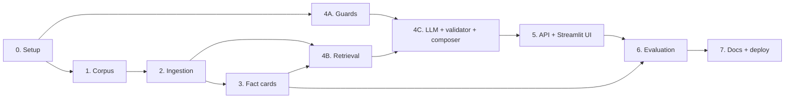

# Implementation Plan: Mutual Fund FAQ Assistant

> **Disclaimer:** Facts-only. No investment advice.

This plan turns [architecture.md](architecture.md) into build phases. Requirements come from [problemStatement.md](problemStatement.md). Section numbers like "§6.2" refer to the architecture document.

Each phase lists its goal, what it depends on, tasks, deliverables and exit criteria. A phase is done only when its exit criteria pass.

Corner cases are listed in [edge-case.md](edge-case.md). Tasks that close a gap found there are tagged with the case IDs, e.g. (EC-INT-16).

How each phase is evaluated, and the system-level release targets, are defined in [eval.md](eval.md). A phase gate is its exit criteria here plus the checks there.

**LLM provider: Groq.** Answers and fact extraction use `openai/gpt-oss-120b` through the official `groq` Python SDK. On Groq this model supports strict JSON-schema output, which the answer step relies on (architecture D7).

**UI and hosting: Streamlit** (architecture D12, decided 13 Nov 2026). The UI is a Streamlit app deployed on Streamlit Community Cloud as a private app. It replaces the static HTML page first built in Phase 5; the FastAPI JSON API stays for local use.

---

## Overview

| Phase | Name | Depends on | Estimate* |
|---|---|---|---|
| 0 | Project setup | — | 0.5–1 day |
| 1 | Corpus definition | 0 | 0.5–1 day |
| 2 | Ingestion pipeline | 1 | 3–4 days |
| 3 | Fact cards | 2 | 2 days |
| 4A | Guards (PII, intent, scheme resolver) | 0 | 2–3 days |
| 4B | Retrieval | 2, 3 | 1–2 days |
| 4C | LLM step, validator, composer, pipeline | 4A, 4B | 2–3 days |
| 5 | API and Streamlit UI | 4C | 2 days |
| 6 | Evaluation and tuning | 3, 5 | 2–3 days |
| 7 | Docs, packaging and deployment | 6 | 1–2 days |

\*Rough estimates for one developer, about 17–23 working days in total. Phase 4A can run in parallel with Phases 1–3.

**Suggested calendar (one developer)**

| Week | Work |
|---|---|
| 1 | Phase 0, Phase 1, start Phase 2. Phase 4A in gaps. |
| 2 | Finish Phase 2, Phase 3, Phase 4B, Phase 4C. |
| 3 | Phase 5, Phase 6. |
| 4 | Phase 7, buffer for tuning and fixes. |

---

## Phase 0: Project Setup

**Status:** done on 11 Nov 2026 (commit `29296e5`). See [eval-log.md](eval-log.md).

**Goal:** an empty but runnable project with the folder layout from §14.

**Depends on:** nothing.

### Tasks

- [ ] Create `pyproject.toml` with the dependencies from §13 (later changes: `trafilatura` removed in Phase 2's switch to BeautifulSoup, `streamlit` and a CPU-only `torch` source added for deployment): `fastapi`, `uvicorn`, `groq`, `sentence-transformers`, `chromadb`, `rank-bm25`, `rapidfuzz`, `httpx`, `trafilatura`, `beautifulsoup4`, `pymupdf`, `pdfplumber`, `pysbd`, `pydantic`, `pydantic-settings`, `slowapi`, `pyyaml`, `tzdata` (time zone data; Windows has none built in, and the footer needs Asia/Kolkata). Dev dependencies: `pytest`, `ruff`.
- [ ] Create the folder skeleton from §14 (`app/`, `ingestion/`, `config/`, `data/`, `eval/`, `tests/`), with empty `__init__.py` files.
- [ ] Add `.gitignore`: `.env`, `data/raw/`, `data/index/`, `data/reports/`, `data/registry.sqlite`, `__pycache__/`, `.venv/`.
- [ ] Add `.env.example` with every variable in the configuration table below.
- [ ] Write `app/settings.py` using `pydantic-settings`, reading the variables below with their defaults. The API key is a secret type, so it never appears when settings are printed (EC-SEC-05).
- [ ] In production (`APP_ENV=production`), refuse to start if `DEBUG_LOG_QUERIES` is on (EC-PII-18).
- [ ] Write a minimal `app/main.py` with `GET /healthz` returning `{"index_loaded": false}`.
- [ ] Add one smoke test and configure `pytest` and `ruff`.

### Configuration

Same as architecture §15.

| Variable | Default | Purpose |
|---|---|---|
| `GROQ_API_KEY` | — | Groq API key. The app starts without it; answers that need the LLM return `503` |
| `GROQ_MODEL` | `openai/gpt-oss-120b` | Model for answers and fact extraction |
| `GROQ_FALLBACK_MODEL` | empty (off) | Optional second model, tried once after a rate limit or server error (e.g. `openai/gpt-oss-20b`) |
| `LLM_REASONING_EFFORT` | `low` | `reasoning_effort` for answers |
| `EXTRACTION_REASONING_EFFORT` | `medium` | `reasoning_effort` for offline fact extraction |
| `LLM_MAX_TOKENS` | `2048` | Completion token limit. Reasoning tokens count toward it |
| `JUDGE_MODEL` | `qwen/qwen3.8-27b` | Advice judge, evaluation only. A different model family from the answer model |
| `APP_ENV` | `development` | `development` or `production` |
| `INDEX_DIR` | `data/index` | Where index versions live |
| `RETRIEVAL_TOP_K` | `5` | Chunks sent to the LLM |
| `MIN_SIMILARITY` | `0.63` | Below this, return `not_found` (set in Phase 4B from the threshold sweep; re-checked in Phase 6) |
| `REQUEST_TIMEOUT_S` | `20` | Per-request time limit |
| `RATE_LIMIT` | `20/minute` | Per-IP limit |
| `DISPLAY_TIMEZONE` | `Asia/Kolkata` | Timezone for the footer date |
| `STALE_SOURCE_DAYS` | `14` | `/healthz` flags pages not fetched for this long |
| `DEBUG_LOG_QUERIES` | `false` | Log redacted questions (local only; blocked in production) |

### Deliverables

- Runnable project skeleton committed to git.

### Exit criteria

- `uv sync` installs cleanly.
- `pytest` passes.
- `uvicorn app.main:app` serves `/healthz`.

---

## Phase 1: Corpus Definition

**Status:** done on 11 Nov 2026, except the human spot-check (EV-1-07). See [eval-log.md](eval-log.md).

**Goal:** a verified list of the official sources for the 7 schemes, and a record of which source holds each fact.

**Depends on:** Phase 0.

**Corpus decision (D1, decided 11 Nov 2026):** official HDFC Mutual Fund sources only. The Groww URLs in the problem statement only identify the schemes (`groww_ref`); they are never fetched, indexed or cited. Reasons: the problem statement allows only AMC, AMFI and SEBI sources and excludes aggregators, and Groww's terms forbid entering its content into a database or redistributing it.

| Scheme | Official scheme page (Direct plan) | Linked PDFs |
|---|---|---|
| HDFC Large Cap Fund | https://www.hdfcfund.com/explore/mutual-funds/hdfc-large-cap-fund/direct | SID, KIM, Fund Facts |
| HDFC Mid Cap Fund | https://www.hdfcfund.com/explore/mutual-funds/hdfc-mid-cap-fund/direct | SID, KIM, Fund Facts |
| HDFC Small Cap Fund | https://www.hdfcfund.com/explore/mutual-funds/hdfc-small-cap-fund/direct | SID, KIM, Fund Facts |
| HDFC Multi Cap Fund | https://www.hdfcfund.com/explore/mutual-funds/hdfc-multi-cap-fund/direct | SID, KIM, Fund Facts |
| HDFC ELSS Tax Saver Fund | https://www.hdfcfund.com/explore/mutual-funds/hdfc-elss-tax-saver-fund/direct | SID, KIM, Fund Facts |
| HDFC Gold ETF Fund of Fund | https://www.hdfcfund.com/explore/mutual-funds/hdfc-gold-etf-fund-fund/direct | SID, KIM |
| HDFC Silver ETF Fund of Fund | https://www.hdfcfund.com/explore/mutual-funds/hdfc-silver-etf-fund-fund/direct | SID, KIM |

Also in the corpus: three statement pages (request statement, consolidated account statement, capital gain statement guide) and the Factsheets index page. Fixed education links, used in replies but never ingested: SEBI Investor Education and AMFI Investor Corner.

### Tasks

**Scheme registry**

- [x] `config/schemes.yaml`: the 7 schemes with `id`, `name`, `category`, `groww_ref` (identifier only), `source_doc_id` and `aliases`.
- [x] Aliases taken from the HDFC MF page names. Every alias contains "hdfc" (EC-SCH-07).
- [ ] Confirm the "former name" aliases against each SID. Moved to Phase 2, when SIDs are parsed.

**Source manifest**

- [x] `config/sources.yaml`: only `www.hdfcfund.com` and `files.hdfcfund.com`. Lists the 7 Direct-plan scheme pages, the 3 statement pages and the Factsheets index.
- [x] Scheme PDFs (SID, KIM, Fund Facts) are found on each scheme page by the start of their link text (`ingestion/linked_docs.py`), because their URLs carry dates and version IDs. Fund Facts exists for the 5 equity schemes only.
- [x] `config/education_links.yaml`: SEBI Investor Education and AMFI Investor Corner, with their own allowlist.
- [x] Manifest tests (`tests/test_manifest.py`): Groww refs match the problem statement, no Groww URL is a source, only HDFC MF hosts, Direct-plan pages only, SID and KIM linked from every scheme page, education links on official hosts.

**Checks**

- [x] robots.txt allows the pages used on `www.hdfcfund.com` (only `smartlink` and `quicklink` paths are disallowed), `www.amfiindia.com` and `www.sebi.gov.in`.
- [x] Terms of use. HDFC MF allows downloading its content "for non-commercial and/or personal use only" and forbids public or commercial use without HDFC AMC's written permission. So the assistant runs locally or as a private demo until permission is given (architecture §16, §18). Groww's terms are stricter.
- [x] `python -m ingestion.check_sources`: 32/32 pass (7 scheme pages, 19 linked PDFs, 3 statement pages, the Factsheets index, 2 education links).
- [x] Raw HTML check: scheme pages are server-rendered, and every fact is in the raw HTML. No headless browser needed.
- [x] Coverage matrix (`docs/coverage-matrix.md`): 49/49 cells filled from the scheme pages and KIMs. Statement questions are covered by the statement pages.
- [x] As-of dates recorded: none for TER, exit load or riskometer; AUM 31/10/2026; Fund Facts October 2026; KIMs and SIDs 21 Nov 2025.
- [x] Draft fact labels (`eval/fact_labels.yaml`): 49 labels, written before any extraction, marked as not yet human-verified.
- [ ] **EV-1-07:** a second person checks 10 random coverage-matrix cells against the live sources, then fills in `verified_by` and `verified_on`.

**Decisions recorded** (architecture §2.1)

- [x] Citations: the official document each answer came from.
- [x] Performance questions: link the scheme's Fund Facts PDF, or the Factsheets page for the two FoFs.
- [x] Statement and capital gains questions: answered from the HDFC MF statement pages.
- [x] Refusal and PII replies: fixed SEBI / AMFI education links.
- [x] The 12 decisions in [edge-case.md](edge-case.md) §18: accepted as proposed.
- [x] UI example questions: Mid Cap expense ratio, ELSS lock-in, capital gains statement.

### Findings for Phase 2

- Every scheme page shows a returns figure, NAV and benchmark performance tables, "Value of Investment of Rs 10,000", "Ideal for" and "Product Suitability". These must be stripped.
- `trafilatura` picks the wrong part of the Small Cap and Multi Cap pages. Read the labeled boxes ("TER", "Min SIP", "Riskometer", …) with BeautifulSoup instead.
- Each page also shows a benchmark riskometer. Take the scheme's.
- The KIM "Minimum Application Amount" table is multi-column. Parse it as a table with `pdfplumber`.

### Deliverables

- `config/schemes.yaml`, `config/sources.yaml`, `config/education_links.yaml`
- `ingestion/manifest.py`, `ingestion/linked_docs.py`, `ingestion/check_sources.py` and their tests
- `docs/coverage-matrix.md`, `eval/fact_labels.yaml`
- The decisions above recorded in `architecture.md`

### Exit criteria

- [x] `check_sources` passes for every source, and the manifest tests pass.
- [x] The coverage matrix is complete, with every gap written down.
- [x] Every decision is made and recorded.
- [ ] EV-1-07 spot-check done by a second person.

### Risk to watch

If HDFC MF blocks scripted requests (HTTP 403 or bot protection), save that document by hand into `data/raw/<doc_id>/` and mark it `fetch: manual` in `sources.yaml`. The official URL is still used for the citation.

---

## Phase 2: Ingestion Pipeline

**Status:** done on 11 Nov 2026. First index `v20261110T211905Z`: 430 chunks from 17 documents. See [eval-log.md](eval-log.md).

**Goal:** one command that turns the source manifest into a versioned search index (§5).

**Depends on:** Phase 1.

### Tasks

**Registry**

- [x] SQLite tables `documents`, `fact_cards` and `index_builds` (§9) with `CREATE TABLE IF NOT EXISTS` (`ingestion/registry.py`).

**Fetch (`ingestion/fetch.py`, §5.1)**

- [x] `httpx` client: 20 s timeout, 3 retries with backoff (429/5xx, honoring `Retry-After` up to 30 s), generic User-Agent, HTTPS only.
- [x] Allowlist checked before the request and on every redirect hop.
- [x] Raw bytes saved to `data/raw/<doc_id>/<fetched_at>.<ext>`, keeping the newest 3 copies.
- [x] Linked PDFs found on each scheme page with `ingestion/linked_docs.py` and fetched. A missing link fails only that document.
- [x] SHA-256 hash of the **extracted text**, not the raw bytes (EC-ING-03).
- [x] Unchanged hash: only `fetched_at` is updated; no re-parsing into chunks, no index rebuild.
- [x] Sanity check on every response (`ingestion/sanity.py`): content type, scheme name, minimum length, required facts and sections. A captcha or empty page fails even with HTTP 200 (EC-ING-01).
- [x] A failed fetch keeps the last good version and is recorded in the run report.
- [x] `fetch: manual` documents read from `data/raw/<doc_id>/`.

**Parse (`ingestion/parse_html.py`, `ingestion/parse_pdf.py`, §5.2)**

- [x] Scheme pages read allowlist-first with `BeautifulSoup`: the labeled fact boxes become a "Key facts" section; only "What is HDFC …?", "Investment Strategy", Fund Managers, Exit Load and factual FAQs are kept. Statement pages are also read with `BeautifulSoup` (headings and text in page order) instead of `trafilatura`, since the page template is the same.
- [x] The scheme's riskometer is taken from the fact box, not the benchmark riskometer.
- [x] KIMs: `pdfplumber` for page text and tables, with table areas cut out of the page text. The "Minimum Application Amount" table becomes "Purchase (including switch-in): ₹100/- …; Additional Purchase …; Redemption …". (`pymupdf` is used for the text-layer check and SID scans rather than KIM text, so table text isn't duplicated.)
- [x] PDFs with no text layer fail the sanity check.
- [x] Scheme pages and their PDFs take `scheme_id` from the manifest. Statement pages have `scheme_id: null`.
- [x] Stripped: returns, NAV and benchmark performance, "Value of Investment of Rs 10,000", "Ideal for", "Why invest", "Who can consider", holdings, "Product Suitability", the KIM suitability table and the KIM "Performance of the Scheme" block (EC-PERF-07, EC-INT-06).
- [x] Former names confirmed in the SIDs and KIMs: "HDFC Top 100 Fund" (Large Cap) and "HDFC Mid-Cap Opportunities Fund" (Mid Cap). No former name is listed for ELSS; "hdfc taxsaver" stays as a common short name.
- [x] Layout quirks handled: Exit Load bullet points as `h3` tags (Multi Cap) and fund-manager headings without "Mr.".

**Normalize and chunk (`ingestion/normalize.py`, `ingestion/chunk.py`, §5.3)**

- [x] Unicode (NFKC), whitespace, line-break hyphens and currency forms ("Rs.", "INR", "Re." → "₹").
- [x] ~300-word windows (≈400 tokens) with a 45-word overlap (≈60 tokens). Tables are never split.
- [x] Context header `[Scheme | Doc type | Section]` on each chunk.
- [x] Chunk metadata: `chunk_id`, `doc_id`, `scheme_id`, `doc_type`, `section`, `source_url`, `doc_as_of`, `page`, `is_table`.

**Embed and index (`ingestion/embed.py`, `ingestion/build_index.py`, §5.5)**

- [x] `BAAI/bge-small-en-v1.5`, normalized vectors, batches of 32.
- [x] ChromaDB (cosine, telemetry off) and `chunks.jsonl` in `data/index/v<timestamp>/`. BM25 is built from `chunks.jsonl` at load time in Phase 4B, rather than stored as a pickle.
- [x] `current` pointer switched only after a successful build (temp file, then `os.replace`).
- [x] Builds recorded in `index_builds`. A build is skipped when the document hashes match the current version.
- [x] SIDs, Fund Facts and the Factsheets index are fetched and registered but not indexed (`index: false` in `sources.yaml`).

**CLI and inspection**

- [x] `python -m ingestion.run`, with `--only <doc_id>` and `--force`. Writes `data/reports/ingest_<time>.md`.
- [x] `python -m ingestion.inspect --scheme <id>` (also `--general`, `--doc-type`, `--grep`).
- [x] `python -m ingestion.audit`: the EV-2-07 to EV-2-10 chunk checks.
- [x] Lock file `data/ingest.lock`. A second run exits with a message (EC-ING-08).

**Tests**

- [x] Synthetic fixtures with the HDFC MF layout (`tests/fixtures/scheme_page.html`, PDFs generated in `tests/fixture_builders.py`). No HDFC MF content is committed.
- [x] Parser tests on the fixtures, plus a check of the saved real pages against `eval/fact_labels.yaml` (skipped when `data/raw/` is empty).
- [x] A table is never split across chunks.
- [x] A non-allowlisted URL and an off-allowlist redirect are both rejected.
- [x] The index pointer is unchanged when a build fails partway.
- [x] A captcha page is treated as a failed fetch.
- [x] Pages differing only in NAV, returns or timestamps give the same content.
- [x] Returns, performance and suitability sections are removed.
- [x] The KIM minimum-amount table parses to the right value for each column.
- [x] A second ingestion run waits for the lock.
- [x] End-to-end run against a fake site: first run, unchanged second run, changed fact, block page, missing PDF link.

### Implementation note

The footer date (D2) should be read from the `documents` table by `doc_id` when composing the response, not from chunk metadata. A document whose content hash is unchanged then shows its new `fetched_at` without rebuilding the index.

### Deliverables

- Working `ingestion/` package, the registry and the first full index.

### Exit criteria

- [x] A build from scratch succeeds and the run report shows every document as fetched, unchanged, failed or skipped (30/30 fetched).
- [x] A second run skips unchanged documents (30/30 unchanged, index not rebuilt).
- [x] `inspect` output looks correct for at least 2 schemes, including the exit-load text and the KIM minimum-amount table (Mid Cap, Small Cap, Gold FoF checked).
- [x] Ingestion tests pass.

---

## Phase 3: Fact Cards

**Status:** built and run on 13 Nov 2026. All 49 cards extracted, every one matching its Phase 1 label, and **waiting for human review** (exit criterion 1). See [eval-log.md](eval-log.md).

**Goal:** reviewed, structured records for the 7 key fields of each scheme (D10, §5.4).

**Depends on:** Phase 2.

### Tasks

- [x] Candidate chunks per scheme and field: the scheme page's "Key facts" (and "Exit Load") chunks are always included, plus the top 4 BM25 matches on field keywords over that scheme's page and KIM chunks.
- [x] One Groq call per scheme × field (`GROQ_MODEL`, `EXTRACTION_REASONING_EFFORT` = `medium`), with `response_format` `json_schema` and `strict: true`. The model returns `status`, `value`, `verbatim_quote`, the id of the source it quoted, and `conflicting`. `source_doc_id`, `source_chunk_id` and `doc_as_of` are filled in from that source, not written by the model.
- [x] Each field names a preferred source (scheme page, or the KIM table for minimum lumpsum). Found on the first live run: without it, the model took the Mid Cap TER from the KIM's *previous financial year* actual expenses (0.76%) instead of the current page value (0.74%).
- [x] Quote check: the quote must appear in the cited source (after normalization), and every number in the value must appear in the quote. A failing card gets one retry with the problems listed, then is stored as `rejected`.
- [x] Diff report `data/reports/fact_diff_<time>.md`: changed or new values versus the previous extraction, label matches, review status, notes.
- [x] Review CLI `python -m ingestion.review_facts`: interactive approve/reject/skip, plus `--list`, `--approve SCHEME:FIELD …` and `--reject … --note`.
- [x] Only **approved** `found` cards are indexed, as `FACT_CARD` chunks whose `source_url` is the document the value came from. `python -m ingestion.run --index-only` rebuilds the index without re-fetching.
- [x] Each card is compared with its Phase 1 label in the diff report and the review screen.
- [x] Re-extraction only when the scheme's sources change (combined hash of its page and KIM), or with `--force`.
- [x] Each card stores its source document's content hash. An approved card whose source has changed is left out of the index until re-reviewed (EC-RET-04, EC-FC-06). Exception: if re-extraction gives the same value and quote from the same document, the approval carries over, so an unrelated page change (such as monthly AUM) doesn't force re-reviewing every card.
- [x] Shared Groq client `app/llm/groq_json.py` (strict JSON, waits out rate limits using `retry-after`, optional fallback model, typed errors). Phase 4C reuses it.

### Tests

- [x] With a fake LLM: a card with a quote that is not in the source is retried, then rejected.
- [x] A changed value in a fixture appears in the diff report with its previous value.
- [x] Unreviewed cards are not indexed.
- [x] A reviewed card whose source hash has changed is withdrawn from the index.
- [x] Also: unchanged sources aren't re-extracted, approval carry-over, label mismatch flagged, LLM outage keeps the previous card, candidate selection, and the Groq client's rate-limit, fallback and bad-reply handling.

### Deliverables

- [x] `ingestion/fact_cards.py`, `ingestion/review_facts.py`, `app/llm/groq_json.py`
- [x] 49 cards (7 schemes × 7 fields), all `found`, none missing. Review pending.

### Exit criteria

- [x] Every applicable card is reviewed: all 49 approved on 13 Nov 2026 at the owner's instruction, as one batch (each card matched its Phase 1 label; no card-by-card check against the live sources). Index `v20261112T210105Z` includes the 49 cards.
- [x] The diff report works on a second run (49/49 skipped, no API calls, 0 changes, 0 label mismatches).

---

## Phase 4A: Guards

**Status:** built on 13 Nov 2026. All EV-4A gates pass on the labeled guard set `eval/guards_set.yaml` (`python -m eval.run_guards`). See [eval-log.md](eval-log.md).

**Goal:** the deterministic checks that run before retrieval (§6.2–6.4). They need no index, so this phase can run alongside Phases 1–3.

**Depends on:** Phase 0.

### Tasks

**PII guard (`app/guards/pii.py`, §6.2)**

- [x] Patterns for PAN, Aadhaar (with Verhoeff checksum), Indian mobile numbers, email, OTP near keywords, and account/folio numbers.
- [x] Returns a match type only, never the matched text, so nothing sensitive is passed on or logged.
- [x] Exclude numbers next to "₹", "Rs", "rupees", "lakh" or "crore" from the account-number pattern, so amounts aren't blocked (EC-PII-13).

**Intent rules (`app/guards/intent.py`, §6.3)**

- [x] Keyword and regex rules for `advisory`, `performance`, `out_of_scope`, `greeting` and `factual`.
- [x] Fixed priority when several match: `advisory` > `performance` > `out_of_scope` > `greeting` > `factual`. For example, "Which fund has better returns?" is advisory.
- [x] `greeting` matches only when the whole message is a greeting, so "Hi! What's the exit load of HDFC Mid Cap?" is still answered (EC-INT-16).
- [x] Exception patterns so factual wording isn't refused: "should I pay", "do I have to pay", "is there a", "best way to", "return / redeem units", "portfolio of". Treat "returns" as performance only next to performance words ("1 year", "%", "CAGR", "gave") (EC-INT-02, EC-INT-03, EC-PERF-02, EC-PERF-09).
- [x] Recognize other AMC names for `out_of_scope`.

**Field detection (`app/retrieval/fields.py`)**

- [x] Map question words to fact-card fields ("exit load" → `exit_load`, "minimum SIP" → `min_sip`, "riskometer" / "risk level" → `riskometer`). Used by the scheme resolver and the retriever boost.

**Scheme resolver (`app/retrieval/scheme_resolver.py`, §6.4)**

- [x] Exact alias match, then `rapidfuzz` ratio ≥ 85 on word windows that start with "hdfc". Changed from token-set ratio, which scores any question containing all of an alias's words as 100 and so can't tell "HDFC Small Cap" from a longer question about another scheme.
- [x] Category words ("ELSS", "silver", "gold", "multi cap") map to schemes.
- [x] **Before** fuzzy matching, detect other AMC names and HDFC schemes outside the corpus. Otherwise "SBI Small Cap" can match the "small cap" alias and return HDFC facts (EC-SCH-06, EC-SCH-07).
- [x] Detect Regular plan, IDCW option, and the plain Gold or Silver ETF (as opposed to the FoF). Their facts differ from the corpus schemes, so they must not resolve to them (EC-SCH-05, EC-SCH-09).
- [x] Generic other-HDFC words ("nifty", "liquid", "focused" …) count as "not covered" only next to "hdfc" and only when no corpus scheme is named, so "Is the benchmark of HDFC Mid Cap NIFTY Midcap 150?" still resolves to Mid Cap. Names that are never a corpus scheme (Flexi Cap, Balanced Advantage, Large & Mid Cap) are always not covered.
- [x] Returns one of: one scheme, general question, scheme needed but missing, several schemes, or not covered (other AMC, other HDFC scheme, Regular/IDCW plan, ETF instead of FoF).

### Tests

- [x] PII true positives: valid PAN, a checksum-valid test Aadhaar number, `+91` mobile, email, "my OTP is 482913".
- [x] PII false positives that must **not** match: "₹500 SIP", "1 year lock-in", "expense ratio 0.75%", a 4-digit year.
- [x] Intent: at least 10 advisory, 5 performance and 5 factual phrasings, including the problem statement's examples.
- [x] Resolver: aliases, typos ("smallcap", "mid-cap"), two schemes in one question, no scheme.
- [x] Resolver: "SBI Small Cap", "HDFC Flexi Cap", "HDFC Mid Cap Regular" and "HDFC Gold ETF" never resolve to a corpus scheme.
- [x] Intent: "Hi! What's the exit load of HDFC Mid Cap?" and "Should I pay exit load if I redeem after 6 months?" are both `factual`.
- [x] PII: "₹1000000000" and "100000000 rupees" are not blocked.
- [x] Also: Verhoeff round trip, a checksum-failing 12-digit number still blocked as an account number (EC-PII-04), full-width characters normalized (EC-IN-08), field detection, closest corpus scheme for not-covered questions, and a test that runs the whole guard set against the EV-4A gates.
- [x] Labeled guard set `eval/guards_set.yaml` (all data made up): 25 PII positives, 25 PII negatives, 65 intent cases (27 advisory, 7 performance, 17 factual, 9 out of scope, 5 greeting) and 33 resolver cases.

### Deliverables

- [x] `app/guards/pii.py`, `app/guards/intent.py`, `app/retrieval/fields.py`, `app/retrieval/scheme_resolver.py` and their tests (`tests/test_guards.py`).
- [x] `eval/guards_set.yaml` and `eval/run_guards.py`.

### Exit criteria

- [x] All guard tests pass (176/176 in the suite).
- [x] The guard flags all 25 PII cases (recall 100%), and `detect_pii` returns only kinds, never the text. That nothing past the guard sees a flagged message is enforced where the pipeline is wired, so it is re-checked in Phase 4C.

---

## Phase 4B: Retrieval

**Status:** built on 13 Nov 2026. All EV-4B gates pass on `eval/retrieval_set.yaml` at `MIN_SIMILARITY` 0.63 (`python -m eval.run_retrieval`). See [eval-log.md](eval-log.md).

**Goal:** hybrid search that returns the right chunks for a resolved scheme (§6.5).

**Depends on:** Phases 2 and 3.

### Tasks

- [x] `app/retrieval/index_loader.py`: at startup, read the `current` pointer and load ChromaDB, BM25 (one per scheme, plus one for the statement pages) and the embedding model. A missing, unreadable or inconsistent index raises `IndexUnavailable` (EC-RET-07). `/healthz` shows `index_version`, `index_built_at` and `chunk_count`. A new index is picked up on restart (EC-RET-08). The model is loaded at startup, so the first question doesn't wait about 6 s.
- [x] `app/retrieval/hybrid.py`:
  - [x] Dense top 10 filtered by `scheme_id` (statement pages when the question has no scheme).
  - [x] BM25 top 10 with the same filter. Tokens drop common words ("the", "fund", "hdfc" …) and get light suffix stripping, so "manages" finds the "Fund Managers" section.
  - [x] Reciprocal Rank Fusion with k = 60.
  - [x] Boost `FACT_CARD` chunks when a field was detected: the scheme's card for each named field is added and ranked first (EC-RET-02).
  - [x] Return the top 5, with the best dense similarity score.
  - [x] Return "nothing relevant" (`relevant: false`) when the best similarity is below `MIN_SIMILARITY`.
- [x] Found while tuning: cards for fields the question didn't name take at most one of the 5 slots. Cards are short, so they score well against any question about the scheme. Without this limit they filled up to 3 slots on "Who manages HDFC Mid Cap?".
- [x] Found while tuning: the dense query has the scheme's name replaced by "the fund". Every chunk in a scheme's scope contains the name, so with it left in, an off-topic question that names a scheme ("Which colour is the HDFC Mid Cap logo?", 0.72) scored above real questions. With the name replaced, the lowest answerable question scores 0.646 and the highest off-topic one 0.614.
- [x] `MIN_SIMILARITY` set to **0.63** (was 0.45), the midpoint of that gap. At 0.45, 70% of the off-topic questions passed. Phase 6 re-checks it on the golden set and the held-back questions. The margin is small (±0.016), so it is worth watching.
- [x] Retrieval set `eval/retrieval_set.yaml`: 85 answerable questions (all 7 schemes, all 7 fields, fund managers, KIM topics, statement pages) with gold passages named by fact-card id, section or key phrase (never by fact value), plus 20 off-topic questions (4 of them name a scheme). Runner `eval/run_retrieval.py` reports EV-4B-01 to 06, MRR and the threshold sweep.

### Tests

- [x] Over a small fixture index: "exit load mid cap" returns the mid-cap fact card or page chunk in the top 3 (the card is first).
- [x] A question about one scheme never returns another scheme's chunks, even when both schemes have identical exit-load text.
- [x] An unrelated question ("what is the weather") falls below the threshold.
- [x] Also: an off-topic question naming a scheme isn't lifted by the name, the unrequested-card limit, two named fields both ranked first, stemming, a scheme with no chunks, missing and inconsistent indexes, and `/healthz` with and without an index. The fixture index uses a hashed bag-of-words fake embedder, so the tests need no model download.

### Deliverables

- [x] `app/retrieval/index_loader.py`, `app/retrieval/hybrid.py`, `/healthz` index fields in `app/main.py`, `tests/test_retrieval.py`.
- [x] `eval/retrieval_set.yaml` and `eval/run_retrieval.py`.

### Exit criteria

- [x] Retrieval tests pass (193/193 in the suite).
- [x] A manual check of 10 real questions not in the retrieval set shows a correct supporting chunk in the top 5 for each (10/10). One side finding: the Gold FoF KIM has a near-empty table chunk ("money market instruments)"), left over from table parsing. Harmless, but worth a look in Phase 6.

---

## Phase 4C: LLM Step, Validator, Composer and Pipeline

**Status:** built on 13 Nov 2026. All tests, the validator set (EV-4C-01/02) and the generation set (EV-4C-03 to 09, 1 rep with the real model) pass, and the three example questions are answered correctly. Release runs should use 3 reps. See [eval-log.md](eval-log.md).

**Goal:** the full question-to-answer pipeline (§6.6–6.8), testable without API cost.

**Depends on:** Phases 4A and 4B.

### Tasks

**LLM client (`app/llm/client.py`, `prompts.py`, `schemas.py`, §6.6)**

- [x] Groq client (`groq` SDK, `client.chat.completions.create`) with model from `GROQ_MODEL`, `reasoning_effort` from `LLM_REASONING_EFFORT` and the token limit from `LLM_MAX_TOKENS`. `AnswerClient` sits on the Phase 3 `GroqJSONClient`, with `REQUEST_TIMEOUT_S` as the SDK timeout.
- [x] Structured output: `response_format={"type": "json_schema", "json_schema": {"name": "faq_answer", "strict": True, "schema": ...}}`. "No source" is `""` rather than null, so the schema has plain types only. The reply is parsed with `json.loads` and validated with the pydantic model; a reply that doesn't match counts as bad output.
- [x] `finish_reason` checked before using the content. `length` (cut off) or empty content counts as a failure: one retry, then `not_found`.
- [x] SDK errors from most to least specific: rate limit (waits for `retry-after` once), timeout, other API status errors, connection errors. With `GROQ_FALLBACK_MODEL` set, it is tried once after a rate limit or server error, and the serving model is logged. Otherwise `ServiceUnavailable` (503 in Phase 5).
- [x] Fixed system prompt in `prompts.py` (§6.6 draft plus "never infer a value the sources don't state" and "name the scheme"). The `<sources>` block has XML-escaped chunk text, with the chunk header moved into attributes.
- [x] The client takes any `JSONCompleter`, so tests pass in a fake.

**Validator (`app/guards/output_validator.py`, §6.7)**

- [x] Status handling, `source_id` membership, ≤ 3 sentences (`pysbd`, each line or bullet counts; "approx." protected), English, no links, number/percentage/date grounding against the cited chunk, advisory and return-figure phrase checks.
- [x] Grounding also accepts the cited document's `doc_as_of` (chunk metadata and registry) and numbers from the user's question (EC-FLD-12).
- [x] Returns a list of failed checks (code for the log, message for the retry).

**Retry flow**

- [x] On validation failure, one follow-up with the model's reply and the failed checks. On a second failure, `not_found`.

**Templates and composer (`app/responses/`, `config/templates.yaml`, §6.8)**

- [x] Template texts, each ≤ 3 sentences (tested).
- [x] Composer builds `ChatResponse`. The citation URL and title come from the registry by `doc_id` (`RegistryDocuments`, read-only, per request). `last_updated` is that document's `fetched_at`.
- [x] Times stored in UTC, footer date shown in Asia/Kolkata as `Last updated from sources: 11 Nov 2026` (EC-CIT-03, EC-CIT-09).
- [x] "Not covered" wording for Regular/IDCW plans and ETFs names the covered Direct Growth or FoF scheme and links its page (EC-SCH-05, EC-SCH-09). Other fund houses and other HDFC schemes link AMFI.
- [x] `performance_redirect` links the scheme's Fund Facts PDF from the registry, or the Factsheets page for the two FoFs and for questions without a scheme. NAV questions link the scheme page (EC-PERF-05).
- [x] Education links from `config/education_links.yaml`: SEBI for refusals and PII replies, AMFI for scope replies and `not_found` without a scheme. Their footer date is the newest `fetched_at` in the registry (recorded in architecture §6.8).

**Orchestrator (`app/pipeline.py`)**

- [x] Order: PII guard → intent rules → scheme resolver → retrieval → LLM → validator → composer. Not-covered checks come before the performance redirect, so another fund's question never links an HDFC factsheet. An advisory question that names a fact field gets the "ask for the fact on its own" refusal (D5).
- [x] Templates work without the index or the LLM; factual questions without them raise `ServiceUnavailable` (EC-RET-07, EC-LLM-12).
- [x] A `request_id` per request and one JSON log line with the §10 fields (type, intent and rule, resolver, scheme, chunk ids, similarity, LLM status, attempts, failed checks, model, tokens, citation URL, latency). No question text; `DEBUG_LOG_QUERIES` adds it in development only and never for a PII message.

**Developer CLI**

- [x] `python -m app.cli ask "<question>"` runs the full pipeline and prints the response, Source line, footer and debug details (`--json` for the raw response).

### Tests (with a fake LLM)

- [x] Each LLM status: `answered`, `insufficient_context`, `advisory`, `out_of_scope`.
- [x] `source_id` not in the retrieved set → retry.
- [x] Four-sentence answer → retry → valid answer passes.
- [x] Answer with a number missing from the source → retry → second failure gives `not_found`.
- [x] `finish_reason: "length"` → retry → `not_found`.
- [x] Rate limit with `GROQ_FALLBACK_MODEL` set → answered by the fallback model, which is logged.
- [x] Every response type has the right citation rule (one link, or none for `clarify` / `greeting`) and the footer where required.
- [x] Log lines never contain the question text.
- [x] An answer whose only date is the document's as-of date passes grounding.
- [x] A fetch at 20:00 UTC shows the next day's India date in the footer.
- [x] Also: PII never reaches retrieval or the LLM, schema-mismatched replies, the LLM being unavailable or not configured, no index, below-threshold `not_found` without an LLM call, the not-covered and performance links, mixed advisory questions, prompt escaping, and validator unit tests.
- [x] Validator set `eval/validator_cases.yaml` (30 good, 30 bad hand-written outputs) with `eval/run_validator.py`, also run as a test.
- [x] Generation set `eval/generation_set.yaml` (49 fact-card questions labeled from `eval/fact_labels.yaml`, 9 others) with `eval/run_generation.py`, which calls the real model with retrieval held fixed. First run (1 rep, 58 questions): correct value 100%, format 100%, grounding 100%, retry rate 0%, `not_found` on answerable 0%, 0 truncated, 826 tokens per call, p95 6.5 s. The p95 is above the ~1–3 s LLM budget in §11; worth watching in Phase 6.

### Deliverables

- [x] `app/llm/client.py`, `prompts.py`, `schemas.py`, `app/guards/output_validator.py`, `app/responses/composer.py`, `documents.py`, `app/models.py`, `app/pipeline.py`, `app/cli.py`, `config/templates.yaml` and tests (`tests/test_pipeline.py`, `tests/test_output_validator.py`).

### Exit criteria

- [x] All tests pass (247/247).
- [x] `app.cli ask` gives correct, cited answers for the three draft example questions using the real model: Mid Cap TER 0.74% (scheme page), ELSS lock-in 3 years (scheme page), capital gains statement via CAMS / KFintech with PAN and email (statement guide). Each passed validation on the first attempt, footer 11 Nov 2026.

---

## Phase 5: API and Streamlit UI

**Status:** built on 13 Nov 2026. The UI moved from a static HTML page to **Streamlit** the same day (architecture D12). API tests and Streamlit `AppTest` tests pass; end-to-end latency passes under the Groq key's token limit (EV-5-08). Still to do by hand in a browser: the visual checklist below. See [eval-log.md](eval-log.md).

**Goal:** the Streamlit UI (§8) and the optional JSON API (§7) over the same pipeline.

**Depends on:** Phase 4C.

### Tasks

**Streamlit UI (`streamlit_app.py`, `app/ui.py`, `config/ui.yaml`, `.streamlit/config.toml`)**

- [x] Disclaimer **"Facts-only. No investment advice."** at the top (sticky container) and in the sidebar.
- [x] Welcome message and three example-question buttons from `config/ui.yaml`. Clicking one sends it.
- [x] Each answer shows the text, a "Source" link (the citation title) and the footer `Last updated from sources: 11 Nov 2026`.
- [x] Answer text rendered as escaped Markdown, so model or source text can't become a link, HTML, emphasis or LaTeX (EC-UI-05). Only `http(s)` citation URLs become links (EC-UI-06).
- [x] A message the PII guard would block is never stored or shown back: the history shows a placeholder. A PII hint sits under the chat box and in the sidebar.
- [x] Rate limits: `RATE_LIMIT` per session and `GLOBAL_RATE_LIMIT` per process (`app/ratelimit.py`), with a "please wait about N seconds" message. Timeout (`REQUEST_TIMEOUT_S`) and unavailability give friendly messages.
- [x] One answer at a time: `runner.fastReruns = false`, and a second click on the same question within 3 s is ignored (EC-UI-01/02).
- [x] History in session memory only, cleared on reload or with "Clear conversation" (EC-UI-08). Usage statistics off, error details hidden.
- [x] Without an index or API key the page says factual answers are unavailable; template replies still work (EC-RET-07, EC-LLM-12).
- [x] First start on a fresh host (`app/bootstrap.py`): import the reviewed fact cards (`config/reviewed_fact_cards.yaml`, made with `python -m ingestion.card_export export`), fetch the sources, build the index, load the pipeline.
- [x] Removed: the static page (`app/static/`), its route and its tests.

**JSON API (`app/main.py`, `app/api/routes.py`), optional**

- [x] `POST /api/chat`: `message` 1–500 Unicode characters after trimming, extra fields rejected, `ChatResponse` back, `REQUEST_TIMEOUT_S` limit.
- [x] `GET /api/meta` (shared `app/meta.py`) and `GET /healthz` (index version, build date, chunk count, `llm_configured`, `stale_sources`).
- [x] `slowapi` rate limit per client address; behind a proxy, uvicorn's `--proxy-headers` with `--forwarded-allow-ips` set to the host's proxy only (EC-API-05).
- [x] Error mapping: `422` field names only (EC-PII-15, EC-API-01/02), `429` with `Retry-After`, `503` with a reason code, `405`, generic `500` logging the error type only.
- [x] JSON only: no CORS middleware, `default-src 'none'` Content Security Policy, `nosniff`, no API docs.

### Tests

- [x] Streamlit UI (`tests/test_streamlit_ui.py`, `AppTest`, real pipeline with a fake LLM): disclaimer, title, three examples and the chat box; a typed question gets a cited answer with the footer; an example button sends its question; a PAN is never shown back or stored and never reaches the LLM; the session rate limit; no index; no LLM; "Clear conversation"; Markdown escaping; only http(s) links.
- [x] Deployment support (`tests/test_deploy.py`): rate-limit parsing and the sliding window, card export/import (approved only, local review wins, hashes kept), the committed export, and the bootstrap (reuse an index, build when missing, keep serving templates when the build fails).
- [x] API (`tests/test_api.py`): validation errors without input echo (a 600-character message with a PAN), Unicode length, `405`, `429` with `Retry-After`, `503` and timeout, `500`, `/api/meta`, `/healthz`, security headers, no CORS, no docs, and end to end with the real pipeline.

### Live checks (13 Nov 2026, real index and Groq)

- [x] 20 real questions through the API: every response had the expected type and citation. Back to back, p95 15.5 s because the key allows **8,000 tokens per minute** (about 4 answers); paced under that, **p50 0.51 s, p95 0.88 s** (EV-5-08). Logs record `rate_limit_wait_s`.
- [x] The Streamlit app with the real startup path (`AppTest`): the Mid Cap expense-ratio example answered in 0.9 s with its citation and footer, and one JSON log line without question text. `streamlit run streamlit_app.py` serves and `/_stcore/health` answers `ok`.
- [x] Fresh-deployment simulation (empty data folder): 49 cards imported, 27 documents fetched, index built in 41 s. The live Gold and Silver FoF pages had changed since the 10 Nov fetch, so 13 cards were withdrawn, and the Silver page failed its sanity check (empty benchmark box; exit load unchanged). The safety rules worked as designed.
- [x] Re-review (13 Nov 2026): local ingestion re-fetched the Gold page; its 7 cards were re-extracted, 5 carried their approval over (same value, quote and document) and 2 were approved by the owner (exit load, minimum lump sum: same facts, reworded or shorter quotes). Local index 479 passages with 49 cards; a fresh deployment now builds 417 passages with 42 cards. The 7 Silver cards wait for HDFC MF's page to show its benchmark again.
- [x] Found and fixed: other fund houses' questions now get the "I only cover these 7 HDFC schemes" reply.
- [x] Noted for Phase 6: "Is the capital gain statement free?" was answered "No, most RTAs … offer it free of cost" (the "No" copied from the source FAQ "Is there any charge?").

### Manual checklist (in a browser: `streamlit run streamlit_app.py`)

- [ ] Disclaimer visible on load and while scrolling.
- [ ] Each example button returns a cited answer with the footer.
- [ ] An advisory question shows a polite refusal with an education link.
- [ ] A message containing a PAN shows the `pii_blocked` reply and the placeholder, not the PAN.
- [ ] Layout works at 375 px width and with keyboard only.
- [ ] Accessibility scan (Lighthouse or axe): no critical issues (EV-5-06).

### Deliverables

- [x] `streamlit_app.py`, `app/ui.py`, `app/bootstrap.py`, `app/ratelimit.py`, `app/meta.py`, `.streamlit/`, `config/ui.yaml`, `config/reviewed_fact_cards.yaml`, `ingestion/card_export.py`, the JSON API and tests.

### Exit criteria

- [x] Tests pass (294/294).
- [ ] The manual checklist is complete.

---

## Phase 6: Evaluation and Tuning

**Status:** tooling built and checked on 13 Nov 2026; first golden run 85/116 cases done. The rest of the golden run, the held-out run and the 3-rep release run wait for Groq quota: the key allows **200,000 tokens per day** for `gpt-oss-120b` (about 100 answers), shared with the deployed app. See [eval-log.md](eval-log.md).

**Goal:** measure the system against the §12 targets and tune it until they are met.

**Depends on:** Phases 3 and 5.

### Tasks

**Golden and held-out sets (`eval/golden_set.yaml`, `eval/holdout_set.yaml`, `eval/build_sets.py`)**

- [x] A pool of 140 cases in the eval.md §11.1 groups: 42 fact (7 schemes × 6 fields) + ELSS lock-in, 10 paraphrases and typos, 6 process (statement pages), 10 advisory, 8 factual-with-advisory-words, 8 performance / NAV / ratings, 6 PII (made-up values), 8 not covered, 6 clarify, 35 edge cases.
- [x] Every edge case marked **E** in [edge-case.md](edge-case.md) has at least one case (`edge_case_ref`); a case may allow two outcomes where edge-case.md does (e.g. Hinglish: answer or `not_found`).
- [x] Fact values from `eval/fact_labels.yaml` (Phase 1, read from the pages before any extraction); other expected phrases read from the official pages. Never from system output. Pending: the EV-1-07 human spot-check of the labels.
- [x] Non-ELSS lock-in: answer ("NA" / no lock-in, as the pages state) or `not_found`.
- [x] Held-out set: 24 cases drawn at random per group (seed 20261113) before any tuning; 116 golden. Not written by a second person (eval.md asks for 5–10 extra held-out questions from someone else: still open).
- [x] `python -m eval.check_sets`: schema, duplicates, groups, edge-case ids, cited documents, no overlap. Passes.

**Graders, judge and runner (`eval/graders.py`, `eval/judge.py`, `eval/run_eval.py`)**

- [x] Graders separate from the app's validator: type, value (normalized, with number boundaries), grounding against the cited chunk, citation document, live citation validity (allowlist, HTTP 200, value on the freshly fetched page), format, advice phrases, PII not forwarded or logged, not-covered misroutes, refusals and false refusals, latency and tokens.
- [x] Oracle run 116/116 pass, null run 0/116 pass. The oracle run found two grader bugs, both fixed: "1%" matched inside "0.21%", and scheme pages show the TER as a bare "0.79" without "%".
- [x] Advice judge `qwen/qwen3.8-27b` (the only non-gpt-oss model on the key), one-word ADVICE/FACTUAL reply: strict JSON failed often with this model. Calibration on `eval/judge_calibration.yaml` (40 responses): 100% agreement, known-negative test passes. **Labels drafted by the build assistant; the owner should confirm them.**
- [x] Runner: real pipeline with production settings, instrumented LLM client (calls per case), log capture, pacing under 8,000 tokens/min (waits kept out of latency), template-only cases run once, `--resume`, `--score-only`, `--oracle`, `--null`, results / errors / scorecard in `data/reports/eval_<time>_<set>/`.

**First golden run (1 rep, 13 Nov 2026, 85 of 116 cases; daily cap reached)**

- [x] Grounding, citation correctness, citation validity, format compliance: 100%. Advice in any response: 0 (judge on 35 answers). False refusals 0%. PII 5/5 blocked with no LLM call and nothing in the logs. Not-covered 7/7, performance 7/7. p95 1.36 s, 1,568 tokens per answer.
- [x] Four failures, read one by one:
  - [x] `edge-int-09` "Will the NAV of HDFC Mid Cap go up next month?" got the NAV redirect: the prediction rule missed "the NAV *of …* go up". **Fixed** (rule allows a short "of <scheme>"); guard eval still passes.
  - [x] `edge-ret-06` "What would ₹10,000 invested … be worth now?" was refused by the LLM. **Fixed** with a performance rule ("invested … worth", "value of investment"): it now gets the factsheet redirect without an LLM call.
  - [ ] `edge-in-10` (five facts at once): the model returned `insufficient_context` instead of answering three. Proposed prompt change, not yet verified: rule 3 adds "If it asks for more than 3, answer the first 3 that SOURCES support and leave the rest out; do not return "insufficient_context" only because more than 3 were asked."
  - [ ] `edge-perf-06` (AUM): the answer left out "as on 31/10/2026". Proposed prompt change, not yet verified: rule 7 becomes "When the source states a date next to the value you give (for example "as on 31/10/2026"), include that date in your answer."
- [ ] Finish the golden run: `python -m eval.run_eval --set golden --resume data/reports/eval_20261113T032729Z_golden` (31 model-dependent cases left).
- [ ] Try the prompt change above on the golden set (`--reps 1`); keep it only if no passing case breaks.
- [ ] Held-out run, then the 3-rep release run on golden and held-out (about 480k tokens: several days on the free tier, or upgrade to Groq's Dev tier).

**Tuning loop**

- [x] One change at a time, cases that flipped read by hand (the two rule fixes above).
- [x] `MIN_SIMILARITY` 0.63 kept: no golden case fell below it wrongly, and no off-topic case got through in the run so far.
- [ ] Cross-encoder reranker: not needed so far (no ranking errors seen).

### Deliverables

- [x] `eval/golden_set.yaml`, `eval/holdout_set.yaml`, `eval/build_sets.py`, `eval/cases.py`, `eval/check_sets.py`, `eval/graders.py`, `eval/judge.py`, `eval/judge_calibration.yaml`, `eval/run_eval.py`, `tests/test_eval_graders.py`, scorecards in `data/reports/`.

### Exit criteria

- [ ] All §12.2 targets met on the full golden set and on the held-out set, with a 3-rep run. Blocked on Groq quota; the partial run meets every target except the two cases above.

---

## Phase 7: Docs, Packaging and Deployment

**Status:** 13 Nov 2026. README, CI, smoke set and secrets scan done; the private Streamlit app is deployed from `main` and needed its Python version changed to 3.12 (see below). Release checks that need a 3-rep scorecard wait for Phase 6.

**Goal:** the required deliverables and a running private deployment.

**Depends on:** Phase 6.

### Tasks

**README (required by the problem statement)**

- [x] Setup: prerequisites (Python 3.12, uv, Groq key), `uv sync`, `.env`, ingestion, fact-card review and export, `streamlit run streamlit_app.py`.
- [x] Selected AMC and the 7 schemes.
- [x] Architecture overview of the RAG approach, with links to the docs.
- [x] Known limitations (§18), including the Groq daily cap.
- [x] Disclaimer snippet: **"Facts-only. No investment advice."**
- [x] Deployment steps and troubleshooting for Streamlit Community Cloud, evaluation and release commands.

**Packaging**

- [x] Dependencies in `pyproject.toml` + `uv.lock`, which Community Cloud installs. Linux resolves `torch` to the CPU-only build.
- [x] Index never committed; a fresh deployment builds it at first start with the reviewed fact cards.
- [ ] Optional Dockerfile: not done. Streamlit Community Cloud is the target, and Docker isn't available here to build and check an image (EV-7-03).

**Continuous integration (`.github/workflows/ci.yml`)**

- [x] On every push to `main` and every pull request: `uv sync --frozen` on Python 3.12, ruff, pytest, the guard and validator gates, the dataset checks and the secrets scan. Evals that need the index or Groq run by hand.

**Deployment (Streamlit Community Cloud)**

- [x] App private: "Only specific people can view this app" (owner's screenshot, 13 Nov 2026).
- [x] App deployed from `akashtickoo/growwChatBot`, branch `main`, `streamlit_app.py`.
- [x] Secrets set (`GROQ_API_KEY`, `APP_ENV`, `MIN_SIMILARITY`, rate limits).
- [ ] **Python version: the app was created with 3.14**, so `uv` refused to install (`requires-python ==3.12.*`) and the page stayed on a spinner. Set App settings → General → Python version → **3.12**, save and reboot (or delete and redeploy with 3.12).
- [ ] **Rotate the Groq key**: it was visible in a settings screenshot shared on 13 Nov 2026. Create a new key, update the app's Secrets and the local `.env`, delete the old key.
- [ ] Smoke test the deployed app by hand with the 10 questions in `eval/smoke_set.yaml` (the private app has no public HTTP API); check the sidebar shows the index (about 417 passages).

**Release checks (eval.md §12)**

- [ ] EV-7-01 fresh clone by someone other than the author (the author's fresh-clone run passed: 287 tests, index built in 48 s).
- [x] EV-7-02 README deliverables present.
- [ ] EV-7-03 Docker image: not applicable (no Dockerfile, see above).
- [x] EV-7-04 smoke set: `python -m eval.run_smoke --local` passed 6/6 template cases; the 4 model cases need Groq quota. Deployed app: by hand.
- [x] EV-7-05 secrets scan over the full history: 0 findings (`python -m eval.scan_secrets`, also in CI). The leaked key was in a screenshot, never in git.
- [ ] EV-7-06 index: a deployment builds its own index from the live pages, so its version differs from the evaluated one; compare the passage and card counts instead (local 479 / 49, fresh build 417 / 42 while the Silver FoF page fails its check).
- [ ] EV-7-07 a passing 3-rep scorecard for this commit (Phase 6).

**Refresh routine**

- [x] Runbook in the README.
- [ ] Optional scheduled ingestion job: not done. Each refresh needs a person to review changed fact cards, so it stays a manual monthly routine.

### Deliverables

- README, `.github/workflows/ci.yml`, `eval/smoke_set.yaml`, `eval/run_smoke.py`, `eval/scan_secrets.py`, the private Streamlit app.

### Exit criteria

- [ ] A fresh clone runs by following only the README (by someone other than the author).
- [ ] The deployed app passes the smoke test.

---

## Ongoing Operations: Monthly Refresh

Each month (expense ratio and riskometer values on the pages usually change monthly):

1. Run `python -m ingestion.run`.
2. Read the run report. Fix any failed fetches or moved URLs in `sources.yaml`.
3. Review `fact_diff_<date>.md` with `python -m ingestion.review_facts`.
4. Run `python -m eval.run_eval` and confirm the targets still hold.
5. Export the reviewed cards (`python -m ingestion.card_export export`) and commit `config/reviewed_fact_cards.yaml`.
6. Reboot the Streamlit app so it rebuilds from the current sources. Confirm the index version in its sidebar.

---

## Requirement Traceability

How each problem-statement requirement is built and checked.

| Requirement | Built in | Component | Verified by |
|---|---|---|---|
| Answer facts: expense ratio, exit load, min SIP, lock-in, riskometer, benchmark | 3, 4B, 4C | Fact cards, hybrid retrieval, LLM step | Golden set fact groups |
| Statement / capital gains process | 1, 2, 4B | HDFC MF statement pages (architecture §2.1) | Golden set process group |
| At most 3 sentences | 4C | Validator, templates | Unit tests, eval format compliance |
| Exactly one citation link | 4C | Composer, `source_id` mapping | Unit tests, eval citation checks |
| Footer "Last updated from sources: <date>" | 4C | Composer (D2) | Unit tests, eval format compliance |
| Refuse advisory questions politely, with an education link | 4A, 4C | Intent rules, LLM `advisory` status, refusal template | Intent tests, golden set advisory group |
| Performance questions: link to the official factsheet only | 4A, 4C | Intent rules, `performance_redirect` (Fund Facts PDF or Factsheets page), validator policy check | Golden set performance group |
| Official sources only (AMC, AMFI, SEBI); no aggregators | 1, 2 | HDFC MF allowlist, manifest tests (no Groww URL as a source), education-link allowlist | Manifest tests, ingestion tests, citation validity |
| No PAN, Aadhaar, account numbers, OTPs, email, phone | 4A, 4C, 5 | PII guard, log policy, Streamlit placeholder for blocked messages | PII tests, UI tests, golden set PII group |
| Welcome message, three examples, visible disclaimer | 5 | Streamlit UI, `config/ui.yaml` | UI tests, manual checklist |
| README: setup, AMC + schemes, architecture, limitations | 7 | README | Fresh-clone check |
| Disclaimer snippet | 5, 7 | UI header, README | Manual checklist |

---

## Risks Across Phases

| Risk | Phase | Response |
|---|---|---|
| HDFC MF blocks scripted requests | 1, 2 | Manual save with `fetch: manual`, keeping the official URL for citations. |
| HDFC MF changes page layout, link labels or PDF URLs | 2, 3 | PDFs found by link text, not stored URLs. Sanity check per fetch. Verbatim-quote check and the fact-card diff report catch changed or missing values. |
| Content-use terms (personal, non-commercial only) | 7 | The Streamlit app stays private without HDFC AMC's written permission. |
| Live pages change before a deployment builds its index | 5, 7 | Changed cards are withdrawn and a failing page is left out. Re-review, re-export and reboot after source changes. |
| Table parsing errors in exit-load or expense-ratio tables | 2, 3 | Verbatim-quote check and human review of every card. |
| Intent rules refuse too many factual questions | 4A, 6 | Measure false refusals in the eval and adjust the rules. |
| Groq retires or changes the chosen model | 4C, 6 | The model ID is config. Re-run the generation and golden-set evals after any model change. The client sits behind an interface, so changes stay local. |
| Groq rate limits slow evaluation or fail live requests | 4C, 6 | Throttled eval runner, retries that respect `retry-after`, optional `GROQ_FALLBACK_MODEL`, and a friendly `503`. The free tier's 200,000 tokens per day are shared by the eval and the deployed app: a release eval spans several days or needs the Dev tier. |
| Eval tuning overfits to the golden set | 6 | Held-back questions used only for the final check. |
| API cost during development | 3, 6 | Fake LLM in tests, re-extract fact cards only on changed documents, run the eval deliberately. |
